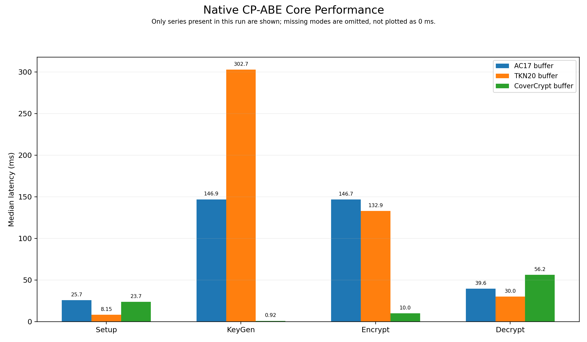
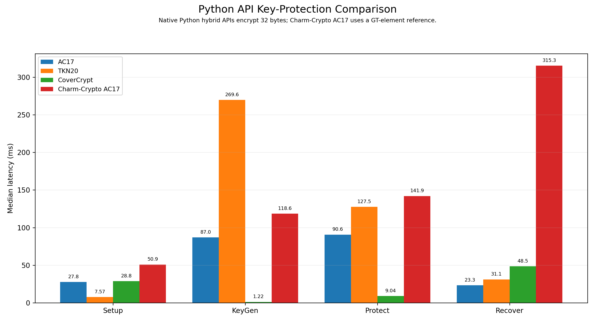
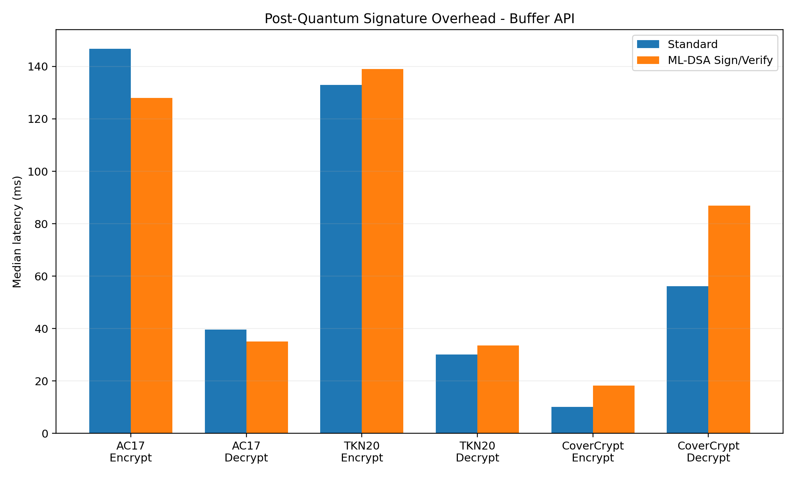

# Hybrid PQ-CP-ABE SDK

A cross-platform post-quantum ciphertext-policy attribute-based encryption SDK for C/C++, Python, and WebAssembly. It supports AC17, TKN20, and CoverCrypt, with AES-GCM for authenticated data encryption and optional ML-DSA signatures. CoverCrypt additionally supports ML-KEM-768 for post-quantum key encapsulation, while AC17 and TKN20 remain classical ABE schemes.

[Latest release](https://github.com/WanThinnn/Hybrid-PQ-CP-ABE/releases/latest) · [Release notes](release_notes/)

<p align="center">
  
</p>

## Quick install

### Python

Install a compatible wheel on Python 3.10 or later. PyPI installation becomes
available after the separate wheel publishing workflow succeeds.

```sh
python -m pip install pq-cp-abe
python -m pq_cp_abe --test
```

The import name is `pq_cp_abe`. Wheels bundle the native runtime for Windows
x64, Linux x64, and macOS Intel and Apple Silicon. For local wheel installation
and examples using the classes and functional API, see the
[Python bindings guide](bindings/python/README.md).


### Node.js

Install the WebAssembly SDK with npm on Node.js 18 or newer.

```sh
npm install @wanthinnn/pq-cp-abe
```

Save this example as `demo.mjs` and run `node demo.mjs` to check the version.

```js
import { PqCpAbe } from '@wanthinnn/pq-cp-abe';

const { api } = await PqCpAbe.create();
console.log(api.getVersion());
```

Run the bundled self-test with `npx @wanthinnn/pq-cp-abe --test`.

See the [Node.js SDK guide](bindings/npm/README.md) for CLI commands and a
CoverCrypt example, and the [WebAssembly guide](bindings/wasm/README.md) for
source builds, browser hosting, and C/C++ linking.

### Native SDK and CLI

Download the ZIP for your platform from the
[GitHub Releases page](https://github.com/WanThinnn/Hybrid-PQ-CP-ABE/releases).
Extract it and run the CLI from the package root:

```sh
./bin/pq-cp-abe version
```

When building from source, run `make install` to make `pq-cp-abe` available
from your shell. See the [CLI installation guide](docs/native/cli.md) for the default
location on each platform and how to set `PREFIX`.

On Windows, run `bin\pq-cp-abe.exe version`. The archive includes headers and
libraries for C/C++ integration. See the [CLI examples](docs/native/cli.md) and
[build guide](docs/native/build.md) for source builds and toolchain setup.

Native source builds default to C++17. To choose another supported standard,
pass `CXX_STANDARD=c++20` to `make` and `make test`; see the
[build example below](#native-sdk-and-cli-1).

The prebuilt Linux x86_64 SDK and Python wheel require glibc 2.34 or newer and
libstdc++ with `GLIBCXX_3.4.29`. Check your glibc with `getconf GNU_LIBC_VERSION`.

## Build from source

The single `configure` file checks the host toolchain without installing or
downloading anything. Missing tools produce a nonzero exit status. Use
`--install` explicitly to install missing tools; OS installers may request
administrator access or interactive completion.

**Check-only does not create activation scripts.** If the check passes and the
current terminal already has the tools on `PATH`, continue directly to the build
steps. Do not source/call a missing activation file. If tools are missing, or
configure finds them but your terminal cannot run them, use the install command
to generate activation, then activate in this same terminal. Installation only
adds tools that are missing or too old.

### Linux / macOS

No Make or Python installation is required just to start the toolchain check:

```sh
chmod +x configure

# Check only
./configure
```

If the check passes in your configured shell, skip to the build commands below.
Otherwise, install missing tools and generate activation:

```sh
./configure --install
. ./build/tools/activate.sh
```

### Windows

**Install the Microsoft C++ build tools first.** Download **Build Tools for
Visual Studio** or Visual Studio from
[Microsoft](https://visualstudio.microsoft.com/downloads/) and select
**Desktop development with C++**, including MSVC x64/x86 tools and a Windows SDK.

Open **x64 Native Tools Command Prompt** for your Visual Studio version from
the Start menu. **Use this one cmd session for setup, activation and build.**
From the repository root:

**Check only** (no installation or activation script generation):

```cmd
powershell.exe -NoProfile -Command ^
    "$text = Get-Content .\configure -Raw;" ^
    "$setup = [scriptblock]::Create(($text -split '(?m)^# WINDOWS CONFIGURE\r?$', 2)[1]);" ^
    "& $setup"
```

**If the check passes and tools are already on this x64 cmd's `PATH`, skip to
the build commands below.** If setup or activation is needed, install missing
tools and generate the script:

```cmd
powershell.exe -NoProfile -Command ^
    "$text = Get-Content .\configure -Raw;" ^
    "$setup = [scriptblock]::Create(($text -split '(?m)^# WINDOWS CONFIGURE\r?$', 2)[1]);" ^
    "& $setup -Install"
```

**After successful install/script generation, activate**, then continue building
in this same cmd:

```cmd
call build\tools\activate.cmd
```

Copy each multiline command including its `^` continuations. PowerShell runs as
a child process and returns to the same cmd. If using generated activation,
run it in each new build session. See the [Windows setup steps](docs/native/build.md#windows) for details.

For WebAssembly setup through MSYS2, see the
[WebAssembly build guide](bindings/wasm/README.md).

### Native SDK and CLI

After setting up the platform toolchain:

```sh
make deps -j8
make -j8
make test -j8
make install
```

The native build defaults to C++17 on Linux, macOS, and Windows. To use C++20,
override `CXX_STANDARD` for each invocation:

```sh
make clean
make -j8 CXX_STANDARD=c++20
make test -j8 CXX_STANDARD=c++20
make install CXX_STANDARD=c++20
```

Run `make clean` when changing standards so existing objects are rebuilt. Staged
dependencies can be reused. `CXX_STANDARD` preserves the other default compiler
flags; the C header check automatically filters out C++ standard flags.

On Linux and macOS, the default install prefix is `/usr/local`, so use
`sudo make install` when installing system-wide, or set a user-writable
`PREFIX`, for example `make install PREFIX="$HOME/.local"`.

See the [native build guide](docs/native/build.md) for detailed toolchain setup
on Windows, Linux, and macOS.

### WebAssembly

On Linux, macOS, WSL, or an MSYS2 MINGW64 shell, check first:

```sh
sh ./configure --wasm                       # Check only
```

**If all tools are `[OK]`, build directly.** Check-only does not generate
activation scripts. If tools are missing, follow the platform-specific
[install and activation steps](bindings/wasm/README.md) first.

```sh
make wasm -j8
make wasm-test -j8
```

See the [WebAssembly build guide](bindings/wasm/README.md) for prerequisites
and output files.

## Benchmarks

v6.1.0 native Buffer API median latency on a 12th Gen Intel Core i5-12450HX
running Windows 10.0.26300, using 100 timed iterations after 5 warm-ups, a
4 KiB payload, and a 12-term policy. CoverCrypt ran in Hybridized mode
(Curve25519 + ML-KEM-768).

<p align="center">
  
</p>

| Scheme | Setup | KeyGen | Encrypt | Decrypt |
| --- | ---: | ---: | ---: | ---: |
| AC17 | 25.723 ms | 146.886 ms | 146.704 ms | 39.635 ms |
| TKN20 | 8.146 ms | 302.714 ms | 132.949 ms | 30.035 ms |
| CoverCrypt | 23.659 ms | 0.923 ms | 10.030 ms | 56.180 ms |

<p align="center">
  
</p>

<p align="center">
  
</p>

See the [benchmark results and methodology](docs/project/benchmarks.md) for detailed
measurements and raw samples.

## Documentation

- [Architecture, CoverCrypt configuration and authority updates](docs/architecture/README.md)
- [Native build, toolchains and repository layout](docs/native/build.md)
- [HashiCorp Vault plugin](plugins/vault/README.md)
- [Release maintenance](docs/project/releases.md)

## License

Project code is licensed under [Apache 2.0](LICENSE). See [NOTICE](NOTICE)
for attribution. Vendored dependencies retain their upstream licenses,
including [BUSL-1.1 for CoverCrypt](vendor/cover_crypt/LICENSE.md).
Contributions intentionally submitted for inclusion in the original project
code are licensed under Apache 2.0 unless explicitly stated otherwise.
