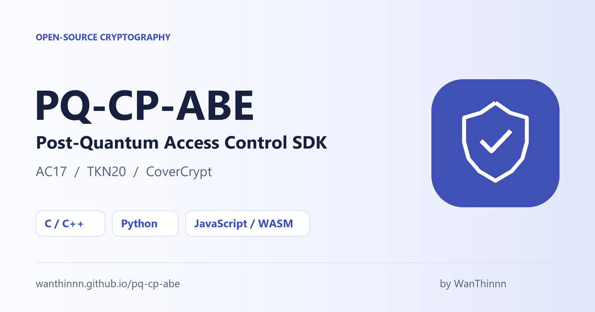
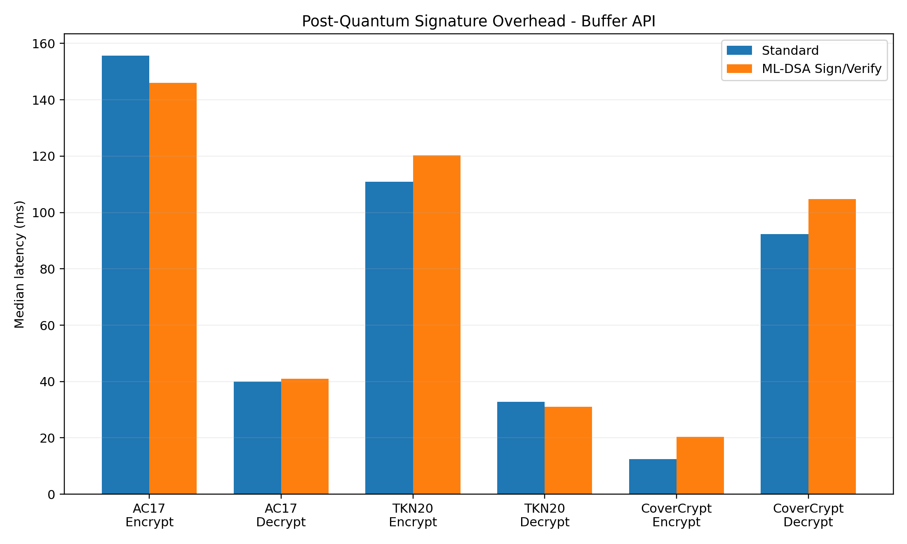

# Hybrid PQ-CP-ABE Library

A ciphertext-policy attribute-based encryption SDK for C/C++, Python, and
WebAssembly. It combines AC17, TKN20, or CoverCrypt with AES-GCM and
optional ML-DSA signatures. CoverCrypt can use ML-KEM-768 for key
encapsulation. AC17 and TKN20 use classical ABE.

[Latest release](https://github.com/WanThinnn/Hybrid-PQ-CP-ABE-Library/releases/latest) · [Release notes](release_notes/)

<p align="center">
  
</p>

## Quick install

### Python

Install a compatible wheel on Python 3.10 or later. PyPI installation becomes
available after the separate wheel publishing workflow succeeds.

```sh
python -m pip install pq-cp-abe
python -m pq_cp_abe --test
```

The import name is `pq_cp_abe`. Wheels bundle the native runtime for Windows
x64, Linux x64, and macOS Intel and Apple Silicon. For local wheel installation
and examples using the classes and functional API, see the
[Python bindings guide](bindings/python/README.md).

### Native SDK and CLI

Download the ZIP for your platform from the
[GitHub Releases page](https://github.com/WanThinnn/Hybrid-PQ-CP-ABE-Library/releases).
Extract it and run the CLI from the package root:

```sh
./bin/pq-cp-abe version
```

When building from source, run `make install` to make `pq-cp-abe` available
from your shell. See the [CLI installation guide](docs/native/cli.md) for the default
location on each platform and how to set `PREFIX`.

On Windows, run `bin\pq-cp-abe.exe version`. The archive includes headers and
libraries for C/C++ integration. See the [CLI examples](docs/native/cli.md) and
[build guide](docs/native/build.md) for source builds and toolchain setup.

The prebuilt Linux x86_64 SDK and Python wheel require glibc 2.34 or newer and
libstdc++ with `GLIBCXX_3.4.29`. Check your glibc with `getconf GNU_LIBC_VERSION`.

### Node.js (WebAssembly)

Install the WebAssembly SDK with npm on Node.js 18 or newer.

```sh
npm install @wanthinnn/pq-cp-abe
```

Save this example as `demo.mjs` and run `node demo.mjs` to check the version.

```js
import { PqCpAbe } from '@wanthinnn/pq-cp-abe';

const { api } = await PqCpAbe.create();
console.log(api.getVersion());
```

Run the bundled self-test with `npx @wanthinnn/pq-cp-abe --test`.

See the [Node.js SDK guide](bindings/npm/README.md) for CLI commands and a
CoverCrypt example, and the [WebAssembly guide](bindings/wasm/README.md) for
source builds, browser hosting, and C/C++ linking.

## Build from source

For the native SDK and CLI, run these commands from the repository root
after setting up the platform toolchain.

```sh
make deps -j8
make -j8
make test -j8
make install
```

See the [native build guide](docs/native/build.md) for toolchain setup on Windows,
Linux, and macOS.

For WebAssembly, set up Emscripten on Linux, macOS, or Windows MSYS2, then run:

```sh
sh ./configure --wasm
make wasm -j8
make wasm-test -j8
```

See the [WebAssembly build guide](bindings/wasm/README.md) for prerequisites
and output files.

## Benchmarks

v6.0.0 native Buffer API median latency on an Intel Core i5-12450HX with
Windows 10, a 4 KiB payload and a 12-term policy. CoverCrypt ran in Hybridized
mode.

<p align="center">
  
</p>

| Scheme | Setup | KeyGen | Encrypt | Decrypt |
| --- | ---: | ---: | ---: | ---: |
| AC17 | 27.184 ms | 146.720 ms | 155.622 ms | 39.902 ms |
| TKN20 | 10.639 ms | 248.388 ms | 110.973 ms | 32.720 ms |
| CoverCrypt | 34.372 ms | 1.101 ms | 12.529 ms | 92.342 ms |

<p align="center">
  
</p>

<p align="center">
  
</p>

See the [benchmark results and methodology](docs/project/benchmarks.md) for detailed
measurements and raw samples.

## Documentation

- [Architecture, CoverCrypt configuration and authority updates](docs/architecture/README.md)
- [Native build, toolchains and repository layout](docs/native/build.md)
- [HashiCorp Vault plugin](plugins/vault/README.md)
- [Release maintenance](docs/project/releases.md)

## License

Project code is licensed under [Apache 2.0](LICENSE). See [NOTICE](NOTICE)
for attribution. Vendored dependencies retain their upstream licenses,
including [BUSL-1.1 for CoverCrypt](vendor/cover_crypt/LICENSE.md).
Contributions intentionally submitted for inclusion in the original project
code are licensed under Apache 2.0 unless explicitly stated otherwise.
