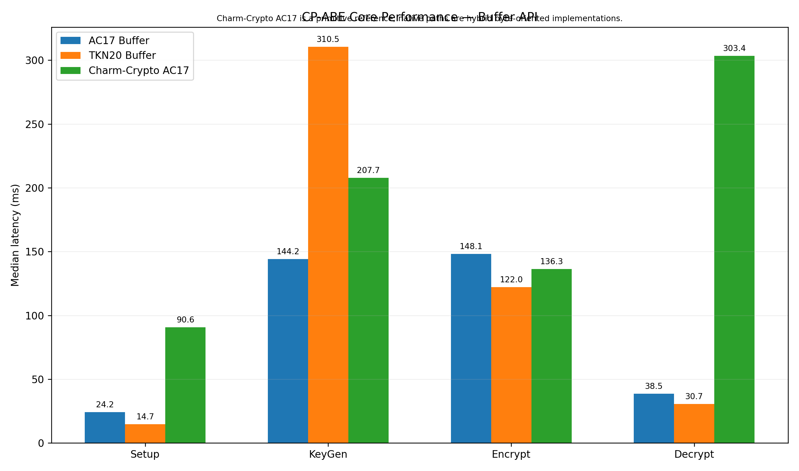

# Hybrid PQ-CP-ABE Library
Hybrid Post-Quantum Ciphertext-Policy Attribute-Based Encryption Library for C/C++ in Windows/Linux


> [!NOTE]
> This library natively includes **Post-Quantum Cryptography (PQC)** integration using `liboqs` (specifically ML-DSA-87 signatures). It introduces a secure "Sign-then-Encrypt" architecture to prevent Surreptitious Forwarding attacks.

> [!IMPORTANT]
> AC17 and TKN20 remain classical pairing-based ABE. The current source also integrates native CoverCrypt with Curve25519 + ML-KEM-768 (Hybridized by default). ML-DSA-87 signing is optional for every scheme. Historical v5.2 benchmark results below describe AC17/TKN20 only.

## Native interface and source layout

The v5.2 public function names and parameters remain unchanged. Select
`CPABE_SCHEME_AC17`, `CPABE_SCHEME_TKN20` or `CPABE_SCHEME_COVERCRYPT` in the existing
`*_with_scheme` functions. Decryption reads the scheme from the ciphertext.
Existing default functions continue to select AC17. Keys are specific to a scheme;
changing the selection does not convert existing keys or ciphertexts.

Windows core builds publish `libcpabe_tkn20.dll` beside the public library in
`lib/` and beside the CLI in `build/artifacts/windows/`. Python bindings load
the public library and its runtime dependencies from `lib/`.

```text
src/hybrid-pq-cp-abe.cpp       Public interface and forwarding
src/core/abe-setup.cpp         Setup and optional signing-key generation
src/core/abe-genkey.cpp        User-key generation
src/core/abe-encrypt.cpp       Encryption and optional signing
src/core/abe-decrypt.cpp       Decryption and optional verification
src/schemes/                  ac17.cpp, tkn20.cpp, covercrypt.cpp
src/crypto/                   aes-gcm.cpp, ml-dsa.cpp
```

All three scheme adapters provide the same eight operations in
`include/hybrid_pq_cp_abe/cpabe-scheme.h`: `setup`, `setupBuffer`, `genkey`,
`genkeyBuffer`, `encapsulate_key`, `decapsulate_key`, `load_pk` and `load_sk`,
each prefixed with its scheme name. The public library interface remains in
`include/hybrid_pq_cp_abe/hybrid-pq-cp-abe.h`.

For CoverCrypt setup, set `HCPABE_COVERCRYPT_CONFIG` to the path of a JSON
configuration. Set `HCPABE_COVERCRYPT_MODE` to `hybridized` (default),
`post_quantum` or `classic`. Applications load their own `.env` files and map
their scheme setting to the enum; the library reads the process environment.

```json
{"dimensions":[{"name":"admin","attributes":["present","absent"]},{"name":"it","attributes":["present","absent"]}]}
```

This configuration accepts the existing attribute list `admin it` and positive
policies such as `admin AND it` or `admin OR it`. Bare names are mapped to the
corresponding `<name>::present` attribute. For native dimensions/hierarchies,
use qualified policies such as `Department::FIN && Security::TOP`. CoverCrypt
does not translate the TKN20 `NOT` syntax; unsupported policies fail explicitly.

For a quick CLI smoke test, use the checked-in [scripts/covercrypt-demo.json](scripts/covercrypt-demo.json)
with `Department::{IT,HR}` and `Level::{USER,ADMIN}`. Run `main --help` for CMD,
PowerShell and Linux/macOS environment commands and a setup/keygen/encrypt/decrypt
example. The demo contains only attribute definitions, not keys. Setup requires
`HCPABE_COVERCRYPT_CONFIG`; the CLI does not automatically read `.env` files.

The file-based CoverCrypt key-generation function persists the updated MSK.
The v5.2 buffer function remains stateless and does not retain the user registry
used by CoverCrypt tracing; this library does not expose tracing operations.
Serialize access to authority files when issuing keys from multiple processes.
See `bindings/covercrypt/README.md` for the native bridge and its upstream license.

## Performance & Benchmarks

The library uses a **hybrid KEM/DEM-style architecture**: CP-ABE protects a randomly generated secret under the access policy, SHA3-256 derives the AES-256 key, and AES-GCM handles the bulk payload. The optional post-quantum path adds **ML-DSA-87 Sign-then-Encrypt** before the payload enters the hybrid encryption pipeline.

For the current binary format, AES-GCM authenticates the header as AAD:

`[Version | Scheme | IV | Encapsulated-Key Length | Encapsulated CP-ABE Key]`

The ML-DSA-87 layer signs:

`[PolicyLen | Policy | Plaintext]`

before encryption.

### Published Benchmark Snapshot

A reproducible benchmark snapshot is published under [`benchmark/published/2026-10-25_i5-12450HX_standard/`](benchmark/published/2026-10-25_i5-12450HX_standard/).

Benchmark environment:

- **CPU:** Intel Core i5-12450HX
- **Library:** v5.2.0
- **Profile:** Standard
- **Timed iterations:** 100 after 5 warm-up iterations
- **Payload:** 4 KiB
- **Policy:** 12 distinct attributes
- **Primary metric:** Median latency
- **Outlier policy:** No samples removed

| Implementation | Setup | KeyGen | Encrypt | Decrypt |
| --- | ---: | ---: | ---: | ---: |
| **AC17 Buffer** | 24.165 ms | 144.200 ms | 148.099 ms | **38.539 ms** |
| **TKN20 Buffer** | **14.710 ms** | 310.463 ms | **122.048 ms** | **30.654 ms** |
| **Charm-Crypto AC17** | 90.553 ms | 207.685 ms | 136.268 ms | 303.351 ms |

<p align="center">
  
</p>

The largest separation in this run appears in **decryption latency**: AC17 Buffer measured **38.539 ms**, TKN20 Buffer **30.654 ms**, and Charm-Crypto AC17 **303.351 ms**. TKN20 also produced the lowest setup and encryption medians in this test, while its KeyGen operation was the most expensive of the three.

### Post-Quantum Signature Cost

ML-DSA-87 primitive measurements for the same published run:

| Operation | Median |
| --- | ---: |
| KeyGen | 0.404 ms |
| Sign | 0.783 ms |
| Verify | 0.276 ms |

In the end-to-end Sign-then-Encrypt benchmark, the measured differences between the standard and ML-DSA-87 paths were smaller than the normal CP-ABE run-to-run variation. The primitive results are therefore the more useful signal for the actual cost of the post-quantum signature layer.

### Reproducibility

The published snapshot includes:

- [`report.md`](benchmark/published/2026-10-25_i5-12450HX_standard/report.md) — methodology, environment, results, and interpretation notes.
- [`summary.csv`](benchmark/published/2026-10-25_i5-12450HX_standard/summary.csv) — median, mean, p95, p99, standard deviation, and coefficient of variation.
- [`raw_samples.csv`](benchmark/published/2026-10-25_i5-12450HX_standard/raw_samples.csv) — every recorded timing sample.
- [`benchmark_results.json`](benchmark/published/2026-10-25_i5-12450HX_standard/benchmark_results.json) — machine-readable results and benchmark metadata.
- [`benchmark/`](benchmark/) — scripts and instructions required to reproduce the tests.

> [!IMPORTANT]
> **Benchmark comparison scope:** the native AC17/TKN20 measurements use the library's in-memory Buffer API and its byte-oriented hybrid pipeline. Charm-Crypto AC17 is also measured in memory, but its API operates directly on a GT group element. Charm is therefore included as a useful reference implementation rather than a strict end-to-end equivalent. The published results should not be interpreted as a universal speedup ratio across all workloads.

> [!NOTE]
> This library is specialized around **AC17** and **TKN20** CP-ABE with a native C/C++ integration surface. For projects that need a broader research-oriented collection of cryptographic schemes such as KP-ABE or IBE, [Charm-Crypto](https://github.com/JHUISI/charm) remains a broader framework.

## Repository Layout

```text
src/                    C++ core implementation only
include/                Public C/C++ API
bindings/python/        Python binding
bindings/tkn20/         Project-owned Go/C bridge for CIRCL TKN20
plugins/vault/          Optional HashiCorp Vault plugin
bindings/covercrypt/    Native Rust/C bridge for CoverCrypt
vendor/cryptopp/        Vendored Crypto++ source
vendor/liboqs/          Vendored Open Quantum Safe source
vendor/librabe-ffi/     Vendored AC17 Rust FFI source
vendor/circl/           Vendored Cloudflare CIRCL v1.6.4 source
vendor/cover_crypt/     Vendored Cosmian CoverCrypt source
lib/                    Generated/prebuilt native libraries
tests/cpp/              Native test suite
build/artifacts/        Core build output grouped by platform
```

`src/` is intentionally reserved for the project's C++ implementation. Optional integrations, bindings, and third-party source live outside it. Core build artifacts are grouped under `build/artifacts/<platform>/`; dependency output remains under `build/deps/<platform>/`.

## Building (Multi-OS)
> [!IMPORTANT]
> This library integrates the following cryptographic primitives and dependencies:
- [CryptoPP Library](https://github.com/weidai11/cryptopp)
- [CP-ABE AC17 Scheme](https://eprint.iacr.org/2017/807) (via [Rabe-ffi](https://github.com/WanThinnn/librabe-ffi.git))
- [CP-ABE TKN20 Scheme](https://eprint.iacr.org/2020/733) (via [Cloudflare CIRCL](https://github.com/cloudflare/circl/tree/main/abe))
- [Open Quantum Safe Library](https://github.com/open-quantum-safe/liboqs) (Open Quantum Safe - required for PQC Signatures)
- [HashiCorp Vault Secrets Engine](plugins/vault/README.md) (optional Go plugin for Enterprise Cryptography-as-a-Service)
- [Cosmian CoverCrypt](https://github.com/Cosmian/cover_crypt) (vendored for the optional post-quantum integration; see `vendor/cover_crypt/`)

> [!NOTE]
>
> **Dependency source of truth:** third-party source is vendored under `vendor/`. Built dependency headers and libraries are normalized under `build/deps/<platform>/`; the top level of that directory contains only `include/` and `lib/` after a successful dependency build.

1. Clone the repository:
    ```sh
    git clone https://github.com/WanThinnn/Hybrid-PQ-CP-ABE-Library.git
    cd Hybrid-PQ-CP-ABE-Library
    ```

Required toolchains: CMake, Rust/Cargo, Go 1.24+, GNU Make, and a native C/C++ compiler. Windows additionally requires Visual Studio 2022/MSVC and MinGW-w64 `gcc` for Go CGO/TKN20.

### Configure a new machine

The single `configure` file checks the host toolchain without installing or
downloading anything. Missing tools produce a nonzero exit status. Use
`--install` explicitly to install missing tools; OS installers may request
administrator access or interactive completion.

Linux/macOS (no Make or Python needed to start the check):

```sh
chmod +x configure
./configure
./configure --install
. ./build/tools/activate.sh
```

Linux installation supports apt, dnf, pacman and zypper. Go is downloaded from
the official Go release metadata with SHA256 verification when needed. macOS
uses Apple Command Line Tools and Homebrew; finish any Apple installer dialog
and rerun `configure --install` if prompted. Rust uses the official rustup
installer. Activation adds local tools to this shell's PATH.

On a fresh Windows machine, PowerShell is already available; Bash is not
required. Run from the repository root to execute the Windows section embedded
in the same file:

```powershell
$text = Get-Content .\configure -Raw
$setup = [scriptblock]::Create(($text -split '(?m)^# WINDOWS CONFIGURE\r?$', 2)[1])
& $setup                 # Check only
& $setup -Install        # Install missing tools
cmd /k build\tools\activate.cmd
```

The Windows installer uses WinGet for Visual Studio C++ Build Tools, MSYS2, Go
and rustup, then MSYS2's package manager for Make/CMake/MinGW. If WinGet is
missing, install Microsoft's App Installer from <https://aka.ms/getwinget> first.
Use the activated x64 command prompt for subsequent `make` commands; it keeps
MSVC's linker ahead of the unrelated MSYS `link.exe`. No `make prepare` or
library-specific Make targets are needed.

Build order from a fresh clone:

1. **Build native dependencies**
   ```sh
   make deps -j8
   ```
   This builds Crypto++, liboqs, librabe-ffi, CIRCL/TKN20, and CoverCrypt. liboqs is configured as a minimal ML-KEM + ML-DSA build only: ML-KEM-512/768/1024 and ML-DSA-44/65/87. The `-jN` budget is distributed across the five dependency builds without oversubscribing the requested total.

2. **Dependency output**
   ```text
   build/deps/<platform>/
   ├── include/
   │   ├── cryptopp/
   │   ├── liboqs/
   │   ├── rabe/
   │   └── tkn20/
   └── lib/
       ├── cryptopp/
       ├── liboqs/
       ├── rabe/
       └── tkn20/
   ```
   Temporary CMake/Cargo/Go/Crypto++ build trees are removed after success. Fingerprint metadata is kept inside each `lib/<dep>/` directory so unchanged dependencies can be skipped on the next build.

3. **Build the Hybrid-CP-ABE native core**
   ```sh
   make -j8
   ```
   The core consumes headers and libraries directly from `build/deps/<platform>/`. After a successful dependency build, `build/deps/<platform>/lib/.ready` marks the dependency set as ready; normal `make -jN` builds do not run the dependency scripts again and go straight to the native core.

4. **Run tests**
   ```sh
   make test -j8
   ```

On Windows, run these commands from an **x64 Native Tools Command Prompt for VS 2022**. Windows uses the MSVC x64 ABI; `librabe-ffi` is forced to `x86_64-pc-windows-msvc`, while TKN20 uses Go/MinGW only behind a C ABI DLL plus an MSVC import `.lib`.

The native C++ library, Crypto++, and liboqs use the dynamic MSVC runtime (`/MD`). Crypto++ still links as a static `.lib`. The dependency builder removes byte-identical duplicate archive members from the Rust static library while preserving its symbols and COFF linker indexes.

After `make`, the build prints the exact include, dependency-library, native-library, shared-library, runtime-DLL, and CLI output paths. `include/` and `lib/` at the repository root are project-only: `include/hybrid_pq_cp_abe/` contains the public Hybrid-CP-ABE API, while `lib/` contains the project static and shared libraries side by side. All third-party headers/libraries stay exclusively under `build/deps/<platform>/`.

Normal core builds are incremental. Use `make clean` only to remove the project core/object output. Use `make deps-clean` to remove the complete dependency output for the current platform.

See [build/README.md](build/README.md) for the output layout. Keep logs under
`build/logs/`, local reports under `build/reports/`, and temporary fixtures under
`build/tmp/`. Reusable diagnostic scripts live in `scripts/diagnostics/`.

**Available Make Commands:**
- `make deps -j8`: Build/check the five native dependencies and print their final include/library layout.
- `make -j8`: Build the native C++ core directly from the existing dependency output. It only auto-builds dependencies when the ready marker is missing (fresh clone or after `make deps-clean`).
- `make deps-clean`: Remove `build/deps/<platform>/`.
- `make static`: Build only the project static library.
- `make shared`: Build only the project shared library.
- `make executable`: Build only the CLI executable.
- `make test -j8`: Incrementally build and run the tests.
- `make tests -j8`: Alias for `make test -j8`.
- `make abi-info`: Show the platform ABI/toolchain policy.
- `make clean`: Remove only project core/object output.

If installed, `sccache` is used automatically where supported. liboqs prefers Ninja when available.

On Windows, `make deps` builds Crypto++ as both a static library and an ordinary,
non-FIPS DLL with the upstream DLL API. `build/deps/windows/lib/cryptopp/` contains
`libcryptopp.lib` (static), `cryptopp.dll`, and `cryptopp.lib` (DLL import library).
DLL consumers include `cryptopp/dll.h` first and link `cryptopp.lib`.

## Usage

### Using the Executable


The usage of the executable is as follows:
```sh
Usage: main [command] [--scheme <name>] [--pqc] [options]
Usage: main setup [--scheme <name>] <path_to_save_file>
Usage: main genkey [--scheme <name>] <master_key_file> <attributes> <private_key_file>
Usage: main encrypt [--scheme <name>] <public_key_file> [pqc_private_key] <plaintext_file> <policy> <ciphertext_file>
Usage: main decrypt <private_key_file> [pqc_public_key] <ciphertext_file> <recovertext_file>
```

Example commands (Standard Mode):
```sh
main setup --scheme tkn20 test_case
main genkey --scheme tkn20 "test_case/cpabe_msk.key" "A B C" "test_case/cpabe_sk.key"
main encrypt --scheme tkn20 "test_case/cpabe_pk.key" "test_case/plaintext.txt" "((A and C) or E)" "test_case/ciphertext.txt"
main decrypt "test_case/cpabe_sk.key" "test_case/ciphertext.txt" "test_case/recovertext.txt"
```

Example commands (Post-Quantum Mode):
```sh
main setup --scheme tkn20 --pqc test_case
main genkey --scheme tkn20 "test_case/cpabe_msk.key" "A B C" "test_case/cpabe_sk.key"
main encrypt --scheme tkn20 --pqc "test_case/cpabe_pk.key" "test_case/pqc_sk.key" "test_case/plaintext.txt" "\"A\"" "test_case/ciphertext.txt"
main decrypt --pqc "test_case/cpabe_sk.key" "test_case/pqc_pk.key" "test_case/ciphertext.txt" "test_case/recovertext.txt"
```
### Integrating the Library
After building the library, you can integrate it into any program on Windows/Linux. Here are the steps to include the library in your project.
See [`bindings/python/`](bindings/python/) for the Python binding.

### HashiCorp Vault Plugin
This library natively provides a **HashiCorp Vault Custom Secrets Engine** written in Go (using Cgo to wrap the C++ core). It enables you to run a true "Cryptography-as-a-Service" architecture where the Master Secret Key (MSK) never leaves the Vault enclave.
- Exposes RESTful APIs: `/v1/abe/setup`, `/v1/abe/genkey`, `/v1/abe/encrypt`, `/v1/abe/decrypt`.
- Multi-stage Docker environments for seamless building and testing.
See [`plugins/vault/README.md`](plugins/vault/README.md) and [`plugins/vault/TESTING.md`](plugins/vault/TESTING.md) for build, test, and deployment instructions.

## Acknowledgements
Special thanks to [Aya0wind](https://github.com/Aya0wind) for Rabe-ffi, [Cloudflare](https://github.com/cloudflare/circl) for CIRCL TKN20, [Open Quantum Safe](https://github.com/open-quantum-safe) for `liboqs`, [CryptoPP](https://github.com/weidai11/cryptopp), and [Cosmian](https://github.com/Cosmian/cover_crypt) for CoverCrypt. CoverCrypt attribution and its BUSL-1.1 license are retained in `vendor/cover_crypt/`.
## GitHub releases

Pushing a `v*` tag or publishing a GitHub Release builds and tests Windows x64
(MSVC), Linux x86_64, macOS Intel, and macOS Apple Silicon on native runners.
All four ZIP packages and `SHA256SUMS.txt` are attached only after every build
and package check succeeds. Running the workflow manually builds downloadable
Actions artifacts without publishing a release. Packages include the CLI,
static/shared libraries, headers, dependency libraries, and license notices.

The workflow must be committed before creating the tag/release. Historical
prebuilt files tracked by Git LFS are not used. Use
`./scripts/release.sh 5.2.1 --dry-run` to preview the four platform packages.
After committing the release changes, `./scripts/release.sh 5.2.1` checks version
metadata and release notes, asks before pushing, then pushes the branch and tag.
It refuses to replace an existing tag. The helper always releases all four
targets and does not accept per-platform flags.

## License

Original project code is licensed under the [Apache License, Version 2.0](LICENSE).
Copyright 2026 Thien Lai. See [NOTICE](NOTICE) for attribution and license scope.

Unless explicitly stated otherwise, contributions intentionally submitted for inclusion in the original project code are provided under the Apache License, Version 2.0.

Third-party code under `vendor/` retains its original license. In particular, `vendor/cover_crypt/` is governed by its bundled BUSL-1.1 license; see `vendor/cover_crypt/LICENSE.md` and `vendor/cover_crypt/UPSTREAM.md`.
