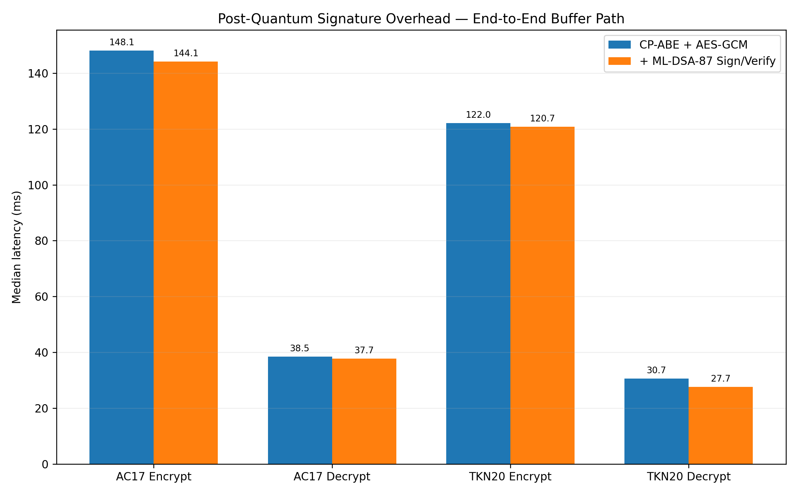
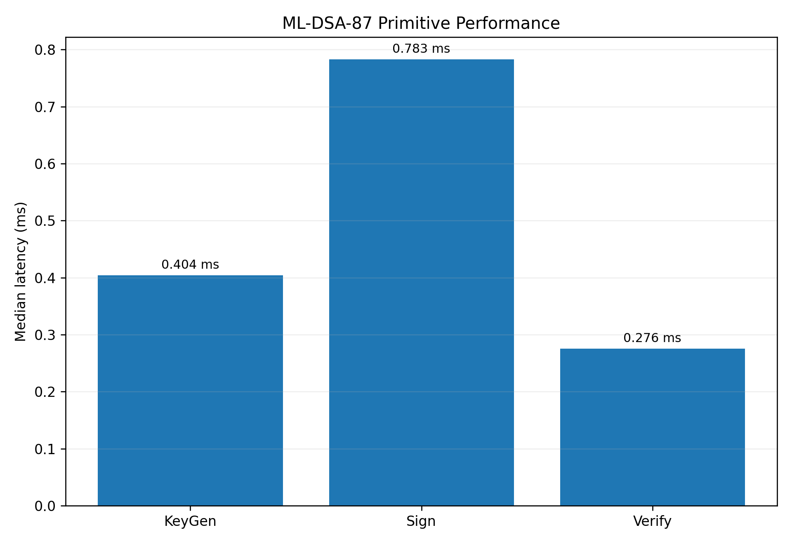
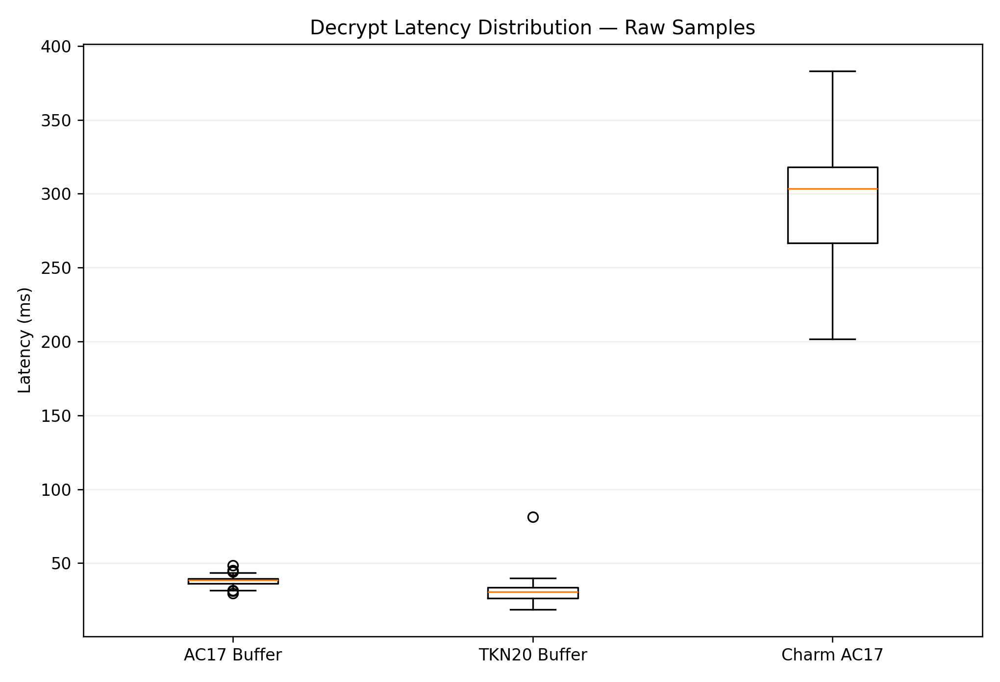

# Hybrid PQ-CP-ABE Showcase Benchmark

Generated: 2026-10-25T06:37:11.881481+00:00

## Scope

This focused run is designed for a concise public performance showcase.

It measures:

- AC17 Buffer API
- TKN20 Buffer API
- Charm-Crypto AC17 reference
- AC17 + ML-DSA-87 Sign-then-Encrypt
- TKN20 + ML-DSA-87 Sign-then-Encrypt
- ML-DSA-87 primitive KeyGen / Sign / Verify

File I/O and scaling suites are intentionally excluded.

## Key observations

- AC17 Encrypt+Sign median overhead: -2.7% (148.099 → 144.085 ms).
- AC17 Decrypt+Verify median overhead: -2.1% (38.539 → 37.720 ms).
- TKN20 Encrypt+Sign median overhead: -1.1% (122.048 → 120.750 ms).
- TKN20 Decrypt+Verify median overhead: -9.7% (30.654 → 27.681 ms).

## Core CP-ABE comparison

| Implementation | Operation | Median (ms) | Mean (ms) | P95 (ms) | P99 (ms) | CV % |\n|---|---|---:|---:|---:|---:|---:|\n| AC17 Buffer | setup | 24.165 | 26.517 | 34.560 | 89.691 | 64.39 |\n| AC17 Buffer | keygen | 144.200 | 140.589 | 162.276 | 171.719 | 12.35 |\n| AC17 Buffer | encrypt | 148.099 | 151.867 | 211.712 | 234.993 | 18.20 |\n| AC17 Buffer | decrypt | 38.539 | 37.966 | 42.289 | 45.130 | 7.94 |\n| TKN20 Buffer | setup | 14.710 | 14.475 | 16.922 | 17.481 | 15.20 |\n| TKN20 Buffer | keygen | 310.463 | 305.175 | 339.691 | 351.573 | 9.27 |\n| TKN20 Buffer | encrypt | 122.048 | 119.802 | 142.177 | 148.780 | 13.38 |\n| TKN20 Buffer | decrypt | 30.654 | 30.493 | 36.110 | 40.271 | 22.99 |\n| Charm-Crypto AC17 | setup | 90.553 | 88.721 | 111.827 | 120.298 | 17.34 |\n| Charm-Crypto AC17 | keygen | 207.685 | 204.586 | 227.623 | 238.135 | 8.54 |\n| Charm-Crypto AC17 | encrypt | 136.268 | 135.538 | 161.488 | 173.273 | 13.55 |\n| Charm-Crypto AC17 | decrypt | 303.351 | 295.276 | 347.474 | 359.434 | 12.63 |

## PQC Sign-then-Encrypt

| Implementation | Operation | Median (ms) | Mean (ms) | P95 (ms) | P99 (ms) | CV % |\n|---|---|---:|---:|---:|---:|---:|\n| AC17 + ML-DSA-87 | setup_pqc | 27.624 | 26.826 | 34.985 | 37.396 | 17.62 |\n| AC17 + ML-DSA-87 | encrypt_sign | 144.085 | 142.709 | 161.782 | 174.694 | 9.24 |\n| AC17 + ML-DSA-87 | decrypt_verify | 37.720 | 36.849 | 44.322 | 46.060 | 13.07 |\n| TKN20 + ML-DSA-87 | setup_pqc | 12.727 | 12.885 | 20.069 | 21.783 | 25.82 |\n| TKN20 + ML-DSA-87 | encrypt_sign | 120.750 | 118.051 | 140.012 | 149.773 | 12.84 |\n| TKN20 + ML-DSA-87 | decrypt_verify | 27.681 | 28.258 | 37.819 | 43.769 | 22.38 |

## ML-DSA-87 primitive

| Implementation | Operation | Median (ms) | Mean (ms) | P95 (ms) | P99 (ms) | CV % |\n|---|---|---:|---:|---:|---:|---:|\n| ML-DSA-87 | keygen | 0.404 | 0.372 | 0.660 | 0.745 | 37.97 |\n| ML-DSA-87 | sign | 0.783 | 0.906 | 1.854 | 2.402 | 47.56 |\n| ML-DSA-87 | verify | 0.276 | 0.271 | 0.412 | 0.460 | 26.01 |

## Charts

## Environment

- CPU: 12th Gen Intel(R) Core(TM) i5-12450HX
- OS: Windows-10-10.0.26300-SP0
- Logical CPUs: 12
- Physical CPUs: 8
- Native library: 5.2.0
- Python: 3.10.8 (tags/v3.10.8:aaaf517, Oct 11 2022, 16:50:30) [MSC v.1933 64 bit (AMD64)]
- Git commit: 320137296b8fc1a240a5580c24c410fa8ec6e6f5

## Benchmark configuration

~~~json
{
  "mode": "showcase",
  "profile": "standard",
  "iterations": 100,
  "warmup": 5,
  "micro_iterations": 250,
  "payload_bytes": 4096,
  "policy_attributes": 12,
  "policy": "(((((((((((ATTR1 AND ATTR2) AND ATTR3) AND ATTR4) AND ATTR5) AND ATTR6) AND ATTR7) AND ATTR8) AND ATTR9) AND ATTR10) AND ATTR11) AND ATTR12)",
  "library_path": "D:\\Documents\\ABE\\Hybrid-CP-ABE-Library\\src\\cpp\\lib\\dynamic\\libhybrid-pq-cp-abe.dll",
  "repo_root": "D:\\Documents\\ABE\\Hybrid-CP-ABE-Library",
  "charm_required": true
}
~~~

## Interpretation note

Charm-Crypto AC17 is included as a reference implementation, not as a strict
apples-to-apples end-to-end equivalent. Charm encrypts/decrypts a GT group
element directly, while the native library exposes a byte-oriented hybrid path
that protects a random secret and uses AES-GCM for payload encryption.

AC17/TKN20 CP-ABE remains classical cryptography. The post-quantum component
measured in the hybrid path is the ML-DSA-87 signature layer.

For public claims, use median/p95 values from the full run and publish the raw
samples together with hardware and build information.
