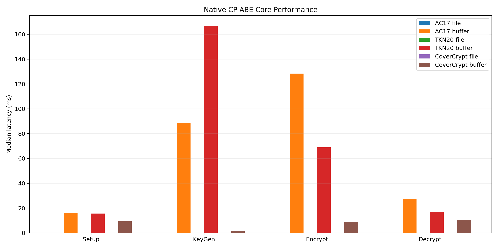
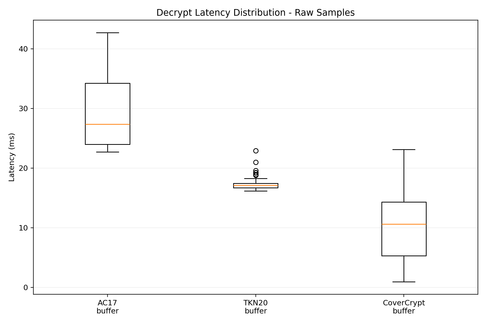
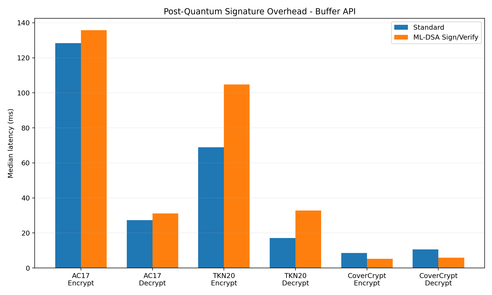
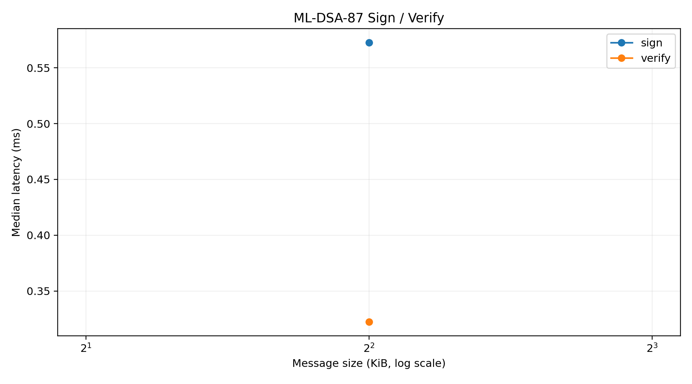

# Hybrid PQ-CP-ABE Performance Benchmark Report

Generated: 2026-10-30T07:41:17.657771+00:00

## Executive summary

This run measures native AC17/TKN20/CoverCrypt performance, File I/O versus
Buffer APIs, ML-DSA-87 Sign-then-Encrypt overhead, ML-DSA and AES-GCM primitives,
policy complexity scaling, and payload-size scaling.

- AC17 Encrypt+Sign overhead: +5.7% median.
- AC17 Decrypt+Verify overhead: +13.7% median.
- TKN20 Encrypt+Sign overhead: +52.0% median.
- TKN20 Decrypt+Verify overhead: +92.2% median.
- CoverCrypt Encrypt+Sign overhead: -39.5% median.
- CoverCrypt Decrypt+Verify overhead: -44.8% median.

## Methodology

- High-resolution monotonic timer: time.perf_counter_ns.
- Warm-up iterations are discarded.
- All measured samples are preserved in raw_samples.csv.
- No outlier removal is performed.
- Primary statistic: median latency.
- Also reported: mean, standard deviation, p95, p99, coefficient of variation,
  and a 95% normal-approximation confidence interval for the mean.
- Python cyclic GC is disabled only inside timed loops.
- File mode intentionally includes library disk I/O.
- Buffer mode keeps key/data transfer in memory.
- Every benchmark family performs a correctness check.
- Baseline policy contains exactly 12 distinct
  attributes; generated scaling labels therefore match the actual policy.
- Baseline payload: 4.00 KiB.

## Charm-Crypto reference

Charm-Crypto AC17 was available.

Charm-Crypto is reported as a primitive reference, not as an apples-to-apples
end-to-end equivalent. Charm AC17 encrypts a GT group element. The native
library exposes a byte-oriented hybrid path that protects a random secret,
derives an AES key, and encrypts data with AES-GCM. Universal speedup claims
must not be inferred directly from this comparison.

## Environment

| Item | Value |
|---|---|
| OS | Windows-10-10.0.26300-SP0 |
| CPU | 12th Gen Intel(R) Core(TM) i5-12450HX |
| Logical CPUs | 12 |
| Physical CPUs | 8 |
| Library | 5.2.1 |
| Python | 3.10.8 (tags/v3.10.8:aaaf517, Oct 11 2022, 16:50:30) [MSC v.1933 64 bit (AMD64)] |
| Git commit | b4cced2e539ac5d17dfdf9fa5f5990339454a0bd |
| Git dirty | True |

## Configuration

{
  "iterations": 100,
  "warmup": 5,
  "micro_iterations": 250,
  "scale_iterations": 30,
  "policy_sizes": [
    1,
    3,
    6,
    12
  ],
  "payload_sizes": [
    1024,
    65536,
    1048576
  ],
  "micro_sizes": [
    1024,
    65536,
    1048576
  ],
  "profile": "standard",
  "payload_bytes": 4096,
  "policy_attributes": 12,
  "policy": "(((((((((((ATTR1 AND ATTR2) AND ATTR3) AND ATTR4) AND ATTR5) AND ATTR6) AND ATTR7) AND ATTR8) AND ATTR9) AND ATTR10) AND ATTR11) AND ATTR12)",
  "attributes": "ATTR1 ATTR2 ATTR3 ATTR4 ATTR5 ATTR6 ATTR7 ATTR8 ATTR9 ATTR10 ATTR11 ATTR12 EXTRA1 EXTRA2 EXTRA3 EXTRA4",
  "seed": 2026,
  "showcase": true,
  "include_file": false,
  "include_pqc": true,
  "include_micro": true,
  "include_scaling": false,
  "include_charm": true,
  "covercrypt_mode": "hybridized",
  "covercrypt_config": "D:\\Documents\\ABE\\Hybrid-CP-ABE-Library\\benchmark\\published\\2026-10-30_i5-12450HX_standard\\_tmp\\covercrypt.json",
  "covercrypt_dimensions": [
    {
      "name": "BENCH_A",
      "attributes": [
        "A1",
        "A2",
        "A3",
        "A4",
        "A5",
        "A6"
      ]
    },
    {
      "name": "BENCH_B",
      "attributes": [
        "B1",
        "B2",
        "B3",
        "B4",
        "B5",
        "B6"
      ]
    }
  ],
  "covercrypt_policy_shape": "OR within each dimension, AND between dimensions",
  "covercrypt_max_policy_attributes": 12,
  "library_path": "D:\\Documents\\ABE\\Hybrid-CP-ABE-Library\\lib\\libhybrid-pq-cp-abe.dll",
  "repo_root": "D:\\Documents\\ABE\\Hybrid-CP-ABE-Library"
}

## Native core

| Scheme | Mode | Variant | Operation | Case | Median ms | Mean ms | P95 ms | P99 ms | CV % |
|---|---|---|---|---|---:|---:|---:|---:|---:|
| CoverCrypt | buffer | standard | setup | baseline | 9.362 | 8.499 | 10.817 | 12.119 | 23.97 |
| CoverCrypt | buffer | standard | keygen | baseline | 1.546 | 1.478 | 1.739 | 1.830 | 15.09 |
| CoverCrypt | buffer | standard | encrypt | baseline | 8.590 | 8.392 | 10.071 | 12.359 | 15.04 |
| CoverCrypt | buffer | standard | decrypt | baseline | 10.596 | 10.213 | 18.953 | 21.698 | 55.16 |
| TKN20 | buffer | standard | setup | baseline | 15.584 | 15.146 | 18.161 | 20.684 | 18.06 |
| TKN20 | buffer | standard | keygen | baseline | 166.818 | 180.053 | 259.259 | 298.696 | 18.87 |
| TKN20 | buffer | standard | encrypt | baseline | 68.978 | 69.780 | 74.396 | 77.528 | 3.43 |
| TKN20 | buffer | standard | decrypt | baseline | 17.106 | 17.287 | 18.921 | 21.013 | 5.54 |
| AC17 | buffer | standard | setup | baseline | 16.202 | 16.395 | 17.578 | 19.395 | 4.69 |
| AC17 | buffer | standard | keygen | baseline | 88.444 | 102.776 | 154.234 | 163.968 | 24.39 |
| AC17 | buffer | standard | encrypt | baseline | 128.421 | 124.754 | 163.850 | 174.499 | 22.55 |
| AC17 | buffer | standard | decrypt | baseline | 27.366 | 29.581 | 40.421 | 41.889 | 20.91 |

## PQC Sign-then-Encrypt

| Scheme | Mode | Variant | Operation | Case | Median ms | Mean ms | P95 ms | P99 ms | CV % |
|---|---|---|---|---|---:|---:|---:|---:|---:|
| CoverCrypt | buffer | pqc | setup_pqc | baseline | 6.272 | 7.121 | 11.149 | 13.476 | 31.48 |
| CoverCrypt | buffer | pqc | encrypt_sign | baseline | 5.199 | 6.263 | 9.755 | 11.041 | 33.22 |
| CoverCrypt | buffer | pqc | decrypt_verify | baseline | 5.853 | 5.654 | 9.519 | 9.746 | 47.54 |
| TKN20 | buffer | pqc | setup_pqc | baseline | 8.274 | 8.423 | 9.006 | 10.408 | 6.83 |
| TKN20 | buffer | pqc | encrypt_sign | baseline | 104.837 | 102.946 | 144.414 | 153.831 | 25.76 |
| TKN20 | buffer | pqc | decrypt_verify | baseline | 32.869 | 32.810 | 37.874 | 40.460 | 11.29 |
| AC17 | buffer | pqc | setup_pqc | baseline | 28.481 | 28.535 | 34.486 | 39.203 | 12.04 |
| AC17 | buffer | pqc | encrypt_sign | baseline | 135.744 | 134.823 | 162.933 | 165.927 | 15.36 |
| AC17 | buffer | pqc | decrypt_verify | baseline | 31.122 | 32.622 | 47.962 | 48.930 | 24.86 |

## ML-DSA-87

| Scheme | Mode | Variant | Operation | Case | Median ms | Mean ms | P95 ms | P99 ms | CV % |
|---|---|---|---|---|---:|---:|---:|---:|---:|
| ML-DSA-87 | native | primitive | keygen | keypair | 0.323 | 0.340 | 0.458 | 0.522 | 16.46 |
| ML-DSA-87 | native | primitive | sign | 4.00 KiB | 0.573 | 0.639 | 1.012 | 1.387 | 36.98 |
| ML-DSA-87 | native | primitive | verify | 4.00 KiB | 0.322 | 0.335 | 0.430 | 0.531 | 15.26 |

## AES-256-GCM

No data.

## Policy scaling

No data.

## Payload scaling

No data.

## Charm reference

| Scheme | Mode | Variant | Operation | Case | Median ms | Mean ms | P95 ms | P99 ms | CV % |
|---|---|---|---|---|---:|---:|---:|---:|---:|
| AC17 | python | primitive_reference | setup | baseline | 69.293 | 73.077 | 110.050 | 115.413 | 30.28 |
| AC17 | python | primitive_reference | keygen | baseline | 190.730 | 192.941 | 231.744 | 250.779 | 13.28 |
| AC17 | python | primitive_reference | encrypt | GT element | 78.835 | 79.908 | 87.948 | 93.558 | 5.46 |
| AC17 | python | primitive_reference | decrypt | GT element | 223.038 | 239.571 | 356.486 | 367.223 | 30.90 |

## Charts

## Limitations

1. Results are specific to this machine, compiler build, CPU power state,
   thermal state, OS scheduling, and background load.
2. File I/O results may be affected by filesystem cache and antivirus.
3. Buffer measurements are the stronger signal for cryptographic hot-path
   latency because they remove most disk overhead.
4. One local benchmark is not a substitute for independent third-party testing.
5. For publishable claims, rerun on multiple machines and publish raw_samples.csv
   together with compiler/build flags.
6. AC17/TKN20 remain classical pairing/discrete-log cryptography. CoverCrypt
   is benchmarked in this repository's default hybridized mode
   (Curve25519 + ML-KEM-768). ML-DSA-87 remains the optional signature layer.
