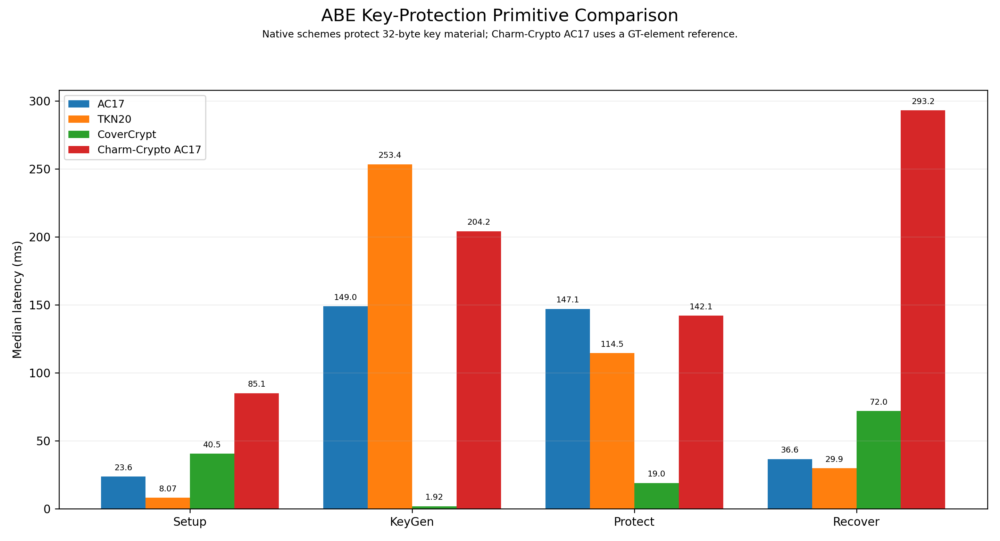
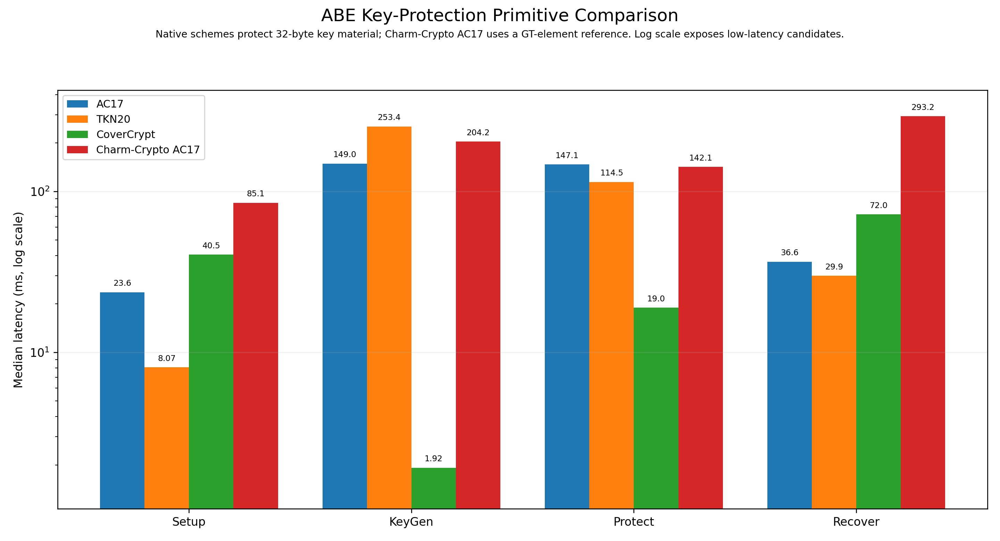
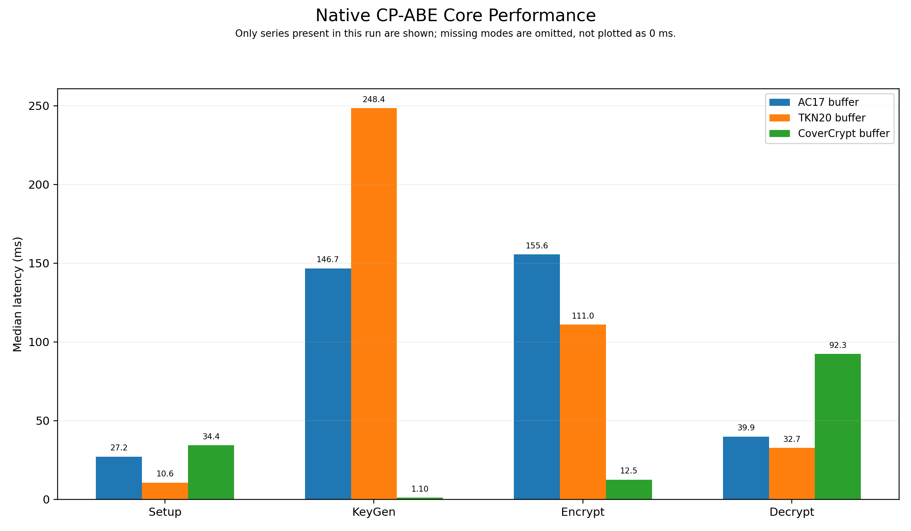
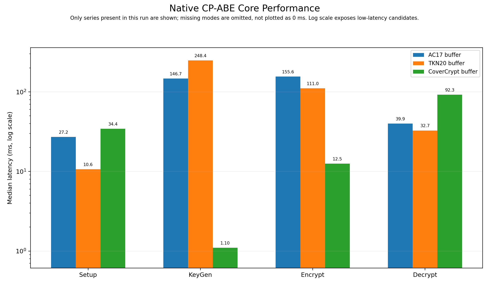
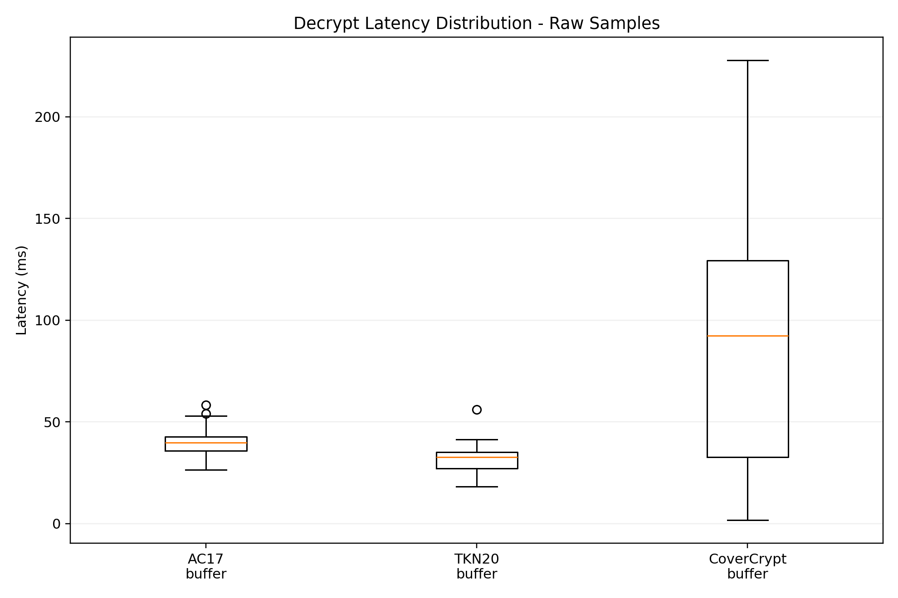
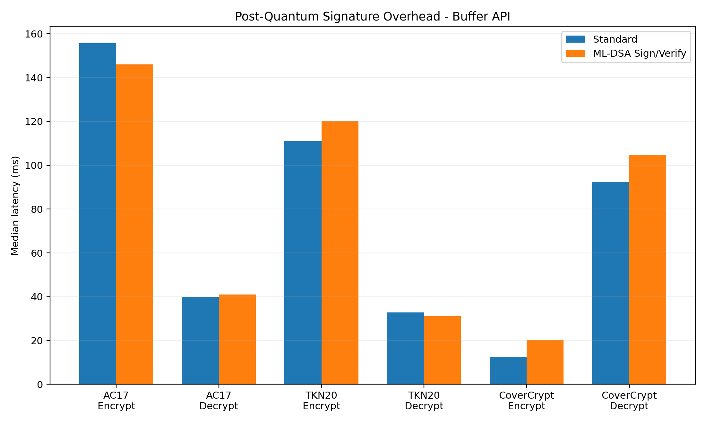
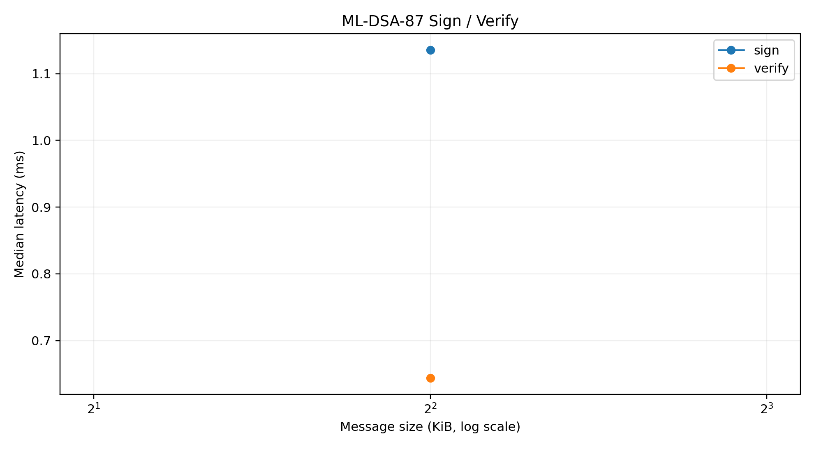

# Hybrid PQ-CP-ABE Performance Benchmark Report

Generated: 2026-11-01T09:20:09.728400+00:00

## Executive summary

This run measures native AC17/TKN20/CoverCrypt performance, File I/O versus
Buffer APIs, ML-DSA-87 Sign-then-Encrypt overhead, ML-DSA and AES-GCM primitives,
policy complexity scaling, and payload-size scaling.

- AC17 Encrypt+Sign overhead: -6.2% median.
- AC17 Decrypt+Verify overhead: +2.9% median.
- TKN20 Encrypt+Sign overhead: +8.3% median.
- TKN20 Decrypt+Verify overhead: -5.1% median.
- CoverCrypt Encrypt+Sign overhead: +62.4% median.
- CoverCrypt Decrypt+Verify overhead: +13.4% median.

## Methodology

- High-resolution monotonic timer: time.perf_counter_ns.
- Warm-up iterations are discarded.
- All measured samples are preserved in raw_samples.csv.
- No outlier removal is performed.
- Primary statistic: median latency.
- Also reported: mean, standard deviation, p95, p99, coefficient of variation,
  and a 95% normal-approximation confidence interval for the mean.
- Python cyclic GC is disabled only inside timed loops.
- File mode intentionally includes library disk I/O.
- Buffer mode keeps key/data transfer in memory.
- Every benchmark family performs a correctness check.
- AC17/TKN20/Charm use 12 logical terms in the baseline policy.
- CoverCrypt maps the same logical-term count across 4 dimensions,
  OR within each dimension and AND between dimensions; this is not the same policy shape.
- Baseline payload: 4.00 KiB.

## Charm-Crypto reference

Charm-Crypto AC17 was available.

Charm-Crypto is reported inside the primitive-comparison suite as a reference,
not as a byte-for-byte equivalent. Charm AC17 encrypts a GT group element.
The three native scheme adapters protect the same 32-byte key material.
CoverCrypt is a KEM, so its adapter uses the hybridized CoverCrypt shared secret
with AES-GCM to wrap that key material. Universal speedup claims must not be
inferred without this scope note.

## Environment

| Item | Value |
|---|---|
| OS | Windows-10-10.0.26300-SP0 |
| CPU | 12th Gen Intel(R) Core(TM) i5-12450HX |
| Logical CPUs | 12 |
| Physical CPUs | 8 |
| Library | 6.0.0 |
| Python | 3.10.8 (tags/v3.10.8:aaaf517, Oct 11 2022, 16:50:30) [MSC v.1933 64 bit (AMD64)] |
| Git commit | 4fb3f113b687d643b0ca25d62ceff2e0664bb08d |
| Git dirty | True |

## Configuration

{
  "iterations": 100,
  "warmup": 5,
  "micro_iterations": 250,
  "scale_iterations": 30,
  "policy_sizes": [
    1,
    3,
    6,
    12
  ],
  "payload_sizes": [
    1024,
    65536,
    1048576
  ],
  "micro_sizes": [
    1024,
    65536,
    1048576
  ],
  "profile": "standard",
  "payload_bytes": 4096,
  "policy_attributes": 12,
  "policy": "(((((((((((ATTR1 AND ATTR2) AND ATTR3) AND ATTR4) AND ATTR5) AND ATTR6) AND ATTR7) AND ATTR8) AND ATTR9) AND ATTR10) AND ATTR11) AND ATTR12)",
  "attributes": "ATTR1 ATTR2 ATTR3 ATTR4 ATTR5 ATTR6 ATTR7 ATTR8 ATTR9 ATTR10 ATTR11 ATTR12 EXTRA1 EXTRA2 EXTRA3 EXTRA4",
  "seed": 2026,
  "showcase": true,
  "include_file": false,
  "include_pqc": true,
  "include_micro": true,
  "include_scaling": false,
  "include_charm": true,
  "include_primitive": true,
  "primitive_bridge": "D:\\Documents\\ABE\\Hybrid-CP-ABE-Library\\build\\artifacts\\windows\\benchmark\\native_primitive_bridge.dll",
  "primitive_key_material_bytes": 32,
  "covercrypt_mode": "hybridized",
  "covercrypt_config": "D:\\Documents\\ABE\\Hybrid-CP-ABE-Library\\benchmark\\published\\2026-11-01_i5-12450HX_standard\\covercrypt_config.json",
  "covercrypt_dimensions": [
    {
      "name": "BENCH_D1",
      "attributes": [
        "V1",
        "V2",
        "V3"
      ]
    },
    {
      "name": "BENCH_D2",
      "attributes": [
        "V1",
        "V2",
        "V3"
      ]
    },
    {
      "name": "BENCH_D3",
      "attributes": [
        "V1",
        "V2",
        "V3"
      ]
    },
    {
      "name": "BENCH_D4",
      "attributes": [
        "V1",
        "V2",
        "V3"
      ]
    }
  ],
  "covercrypt_dimension_count_requested": 4,
  "covercrypt_dimension_count_effective": 4,
  "covercrypt_rights_universe_estimate": 256,
  "covercrypt_policy_shape": "OR within each dimension, AND between dimensions",
  "covercrypt_max_policy_attributes": 12,
  "library_path": "D:\\Documents\\ABE\\Hybrid-CP-ABE-Library\\lib\\libhybrid-pq-cp-abe.dll",
  "repo_root": "D:\\Documents\\ABE\\Hybrid-CP-ABE-Library"
}

## ABE key-protection primitive comparison

| Scheme | Mode | Variant | Operation | Case | Median ms | Mean ms | P95 ms | P99 ms | CV % |
|---|---|---|---|---|---:|---:|---:|---:|---:|
| CoverCrypt | native | key_protection | setup | 32-byte key material | 40.511 | 40.114 | 54.919 | 61.360 | 23.27 |
| CoverCrypt | native | key_protection | keygen | 32-byte key material | 1.921 | 2.110 | 3.052 | 3.510 | 29.31 |
| CoverCrypt | native | key_protection | protect | 32-byte key material | 18.991 | 17.827 | 21.920 | 25.056 | 21.19 |
| CoverCrypt | native | key_protection | recover | 32-byte key material | 72.000 | 80.189 | 163.167 | 193.419 | 66.27 |
| TKN20 | native | key_protection | setup | 32-byte key material | 8.071 | 8.134 | 8.902 | 9.394 | 5.20 |
| TKN20 | native | key_protection | keygen | 32-byte key material | 253.420 | 250.660 | 316.493 | 328.202 | 17.06 |
| TKN20 | native | key_protection | protect | 32-byte key material | 114.548 | 113.173 | 142.337 | 150.285 | 15.21 |
| TKN20 | native | key_protection | recover | 32-byte key material | 29.901 | 29.204 | 37.865 | 40.334 | 19.61 |
| AC17 | native | key_protection | setup | 32-byte key material | 23.650 | 24.717 | 34.456 | 36.267 | 21.05 |
| AC17 | native | key_protection | keygen | 32-byte key material | 148.970 | 147.469 | 168.404 | 174.560 | 11.19 |
| AC17 | native | key_protection | protect | 32-byte key material | 147.055 | 146.252 | 166.304 | 174.422 | 8.95 |
| AC17 | native | key_protection | recover | 32-byte key material | 36.620 | 36.587 | 47.281 | 48.644 | 17.18 |
| Charm-Crypto AC17 | python | GT_reference | setup | GT element | 85.063 | 86.351 | 111.744 | 119.312 | 20.29 |
| Charm-Crypto AC17 | python | GT_reference | keygen | GT element | 204.176 | 197.796 | 234.039 | 241.303 | 15.26 |
| Charm-Crypto AC17 | python | GT_reference | protect | GT element | 142.135 | 139.449 | 160.711 | 165.939 | 12.49 |
| Charm-Crypto AC17 | python | GT_reference | recover | GT element | 293.191 | 288.598 | 346.486 | 360.945 | 14.36 |

Native AC17, TKN20, and CoverCrypt protect/recover the same 32-byte key material.
CoverCrypt runs in hybridized mode (Curve25519 + ML-KEM-768) and, because it is
a KEM, its adapter uses the CoverCrypt shared secret with AES-GCM to wrap that
32-byte key material. Charm-Crypto AC17 is a GT-element reference and is not
byte-for-byte equivalent.

## Native core

| Scheme | Mode | Variant | Operation | Case | Median ms | Mean ms | P95 ms | P99 ms | CV % |
|---|---|---|---|---|---:|---:|---:|---:|---:|
| CoverCrypt | buffer | standard | setup | baseline | 34.372 | 36.092 | 50.872 | 52.740 | 24.39 |
| CoverCrypt | buffer | standard | keygen | baseline | 1.101 | 1.198 | 1.736 | 2.156 | 22.25 |
| CoverCrypt | buffer | standard | encrypt | baseline | 12.529 | 14.366 | 22.941 | 24.361 | 32.59 |
| CoverCrypt | buffer | standard | decrypt | baseline | 92.342 | 87.124 | 178.692 | 203.503 | 65.09 |
| TKN20 | buffer | standard | setup | baseline | 10.639 | 11.992 | 17.832 | 18.715 | 27.76 |
| TKN20 | buffer | standard | keygen | baseline | 248.388 | 250.800 | 305.084 | 333.583 | 13.28 |
| TKN20 | buffer | standard | encrypt | baseline | 110.973 | 114.463 | 145.894 | 153.010 | 17.37 |
| TKN20 | buffer | standard | decrypt | baseline | 32.720 | 31.168 | 39.859 | 41.523 | 21.28 |
| AC17 | buffer | standard | setup | baseline | 27.184 | 28.306 | 34.203 | 100.997 | 54.27 |
| AC17 | buffer | standard | keygen | baseline | 146.720 | 139.633 | 167.217 | 171.865 | 16.17 |
| AC17 | buffer | standard | encrypt | baseline | 155.622 | 152.779 | 168.553 | 177.659 | 8.35 |
| AC17 | buffer | standard | decrypt | baseline | 39.902 | 39.523 | 50.690 | 54.175 | 15.93 |

## PQC Sign-then-Encrypt

| Scheme | Mode | Variant | Operation | Case | Median ms | Mean ms | P95 ms | P99 ms | CV % |
|---|---|---|---|---|---:|---:|---:|---:|---:|
| CoverCrypt | buffer | pqc | setup_pqc | baseline | 39.796 | 38.634 | 51.483 | 54.090 | 22.56 |
| CoverCrypt | buffer | pqc | encrypt_sign | baseline | 20.348 | 19.244 | 24.534 | 27.399 | 21.91 |
| CoverCrypt | buffer | pqc | decrypt_verify | baseline | 104.693 | 106.289 | 185.348 | 193.712 | 53.45 |
| TKN20 | buffer | pqc | setup_pqc | baseline | 15.817 | 14.984 | 18.423 | 19.111 | 19.45 |
| TKN20 | buffer | pqc | encrypt_sign | baseline | 120.223 | 120.693 | 149.826 | 156.986 | 14.75 |
| TKN20 | buffer | pqc | decrypt_verify | baseline | 31.063 | 29.822 | 37.857 | 41.021 | 20.89 |
| AC17 | buffer | pqc | setup_pqc | baseline | 25.862 | 26.092 | 34.971 | 36.744 | 19.05 |
| AC17 | buffer | pqc | encrypt_sign | baseline | 145.974 | 142.510 | 165.096 | 172.423 | 12.17 |
| AC17 | buffer | pqc | decrypt_verify | baseline | 41.041 | 39.839 | 49.668 | 52.212 | 14.29 |

## ML-DSA-87

| Scheme | Mode | Variant | Operation | Case | Median ms | Mean ms | P95 ms | P99 ms | CV % |
|---|---|---|---|---|---:|---:|---:|---:|---:|
| ML-DSA-87 | native | primitive | keygen | keypair | 0.552 | 0.558 | 0.718 | 0.898 | 17.79 |
| ML-DSA-87 | native | primitive | sign | 4.00 KiB | 1.135 | 1.220 | 2.092 | 2.508 | 39.79 |
| ML-DSA-87 | native | primitive | verify | 4.00 KiB | 0.644 | 0.667 | 0.869 | 0.970 | 15.36 |

## AES-256-GCM

No data.

## Policy scaling

No data.

## Payload scaling

No data.

## Charts

## Limitations

1. Results are specific to this machine, compiler build, CPU power state,
   thermal state, OS scheduling, and background load.
2. File I/O results may be affected by filesystem cache and antivirus.
3. Buffer measurements are the stronger signal for cryptographic hot-path
   latency because they remove most disk overhead.
4. One local benchmark is not a substitute for independent third-party testing.
5. For publishable claims, rerun on multiple machines and publish raw_samples.csv
   together with compiler/build flags.
6. AC17/TKN20 remain classical pairing/discrete-log cryptography. CoverCrypt
   is benchmarked in this repository's default hybridized mode
   (Curve25519 + ML-KEM-768). ML-DSA-87 remains the optional signature layer.
