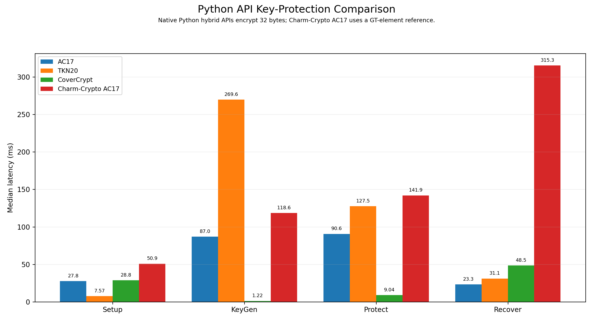
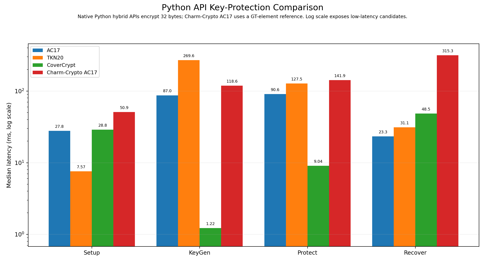
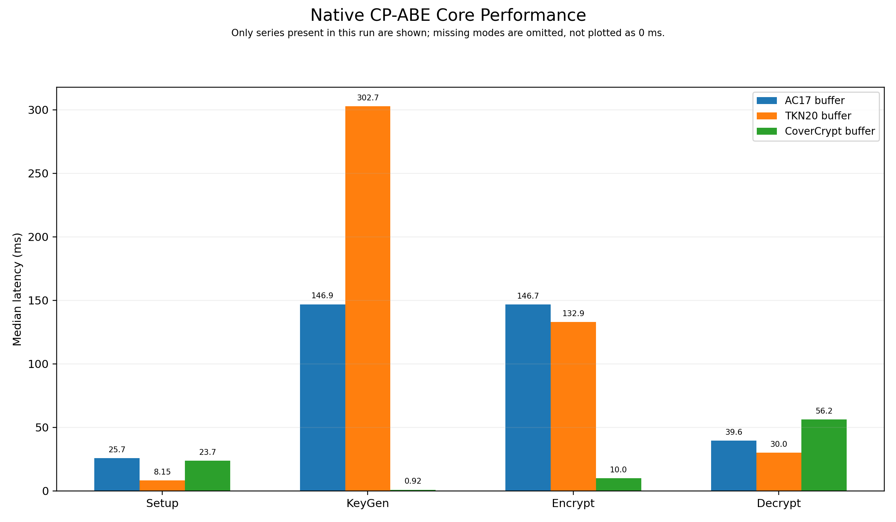
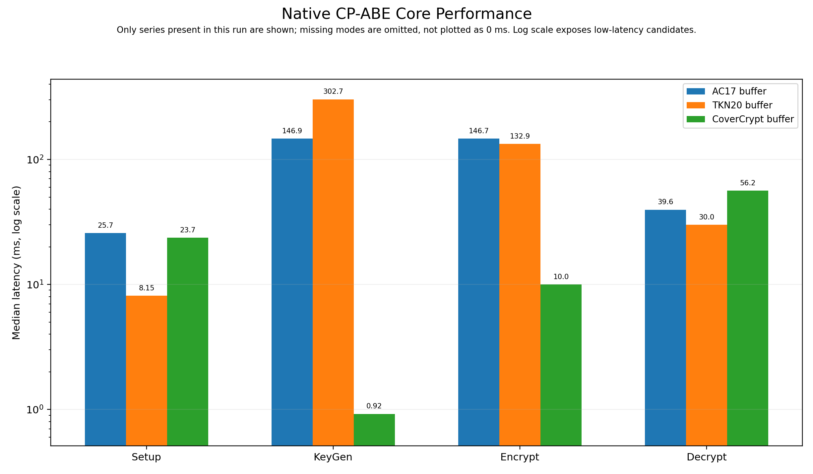
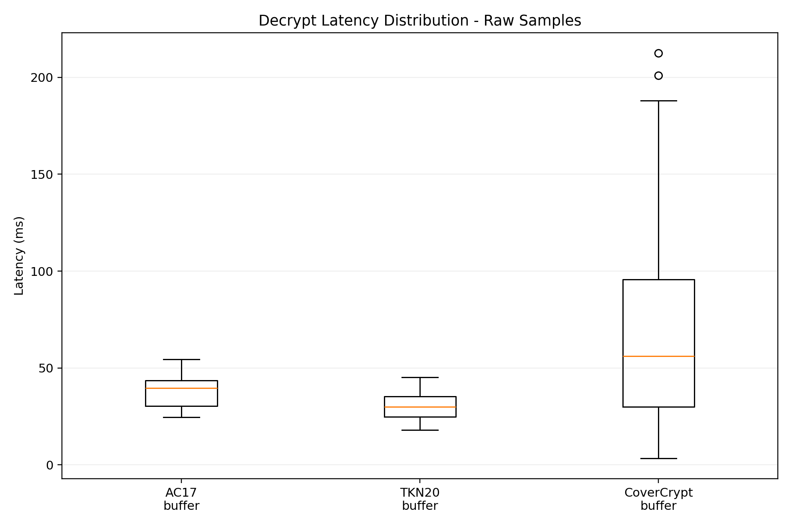
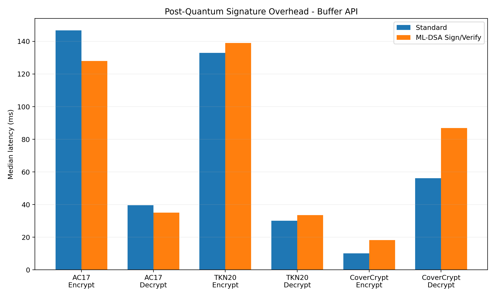
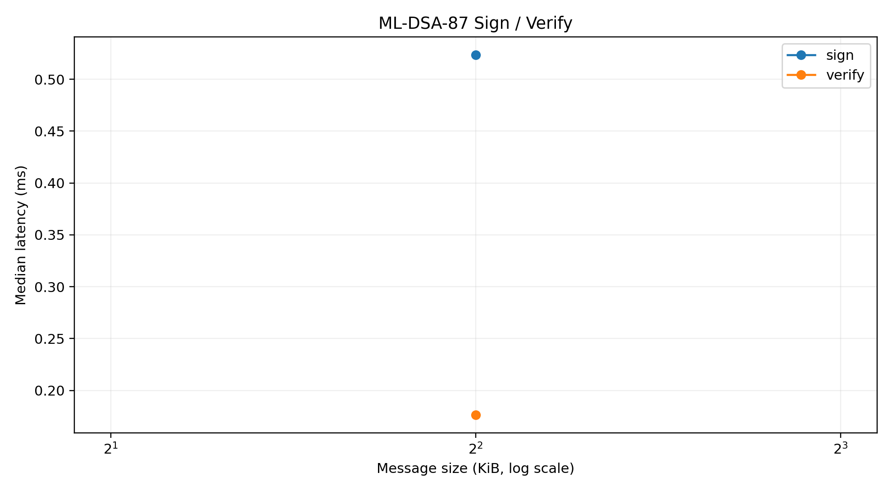

# Hybrid PQ-CP-ABE Performance Benchmark Report

Generated: 2026-11-21T11:32:06.033899+00:00

## Executive summary

This run measures native AC17/TKN20/CoverCrypt performance, File I/O versus
Buffer APIs, ML-DSA-87 Sign-then-Encrypt overhead, ML-DSA and AES-GCM primitives,
policy complexity scaling, and payload-size scaling.

- AC17 Encrypt+Sign overhead: -12.8% median.
- AC17 Decrypt+Verify overhead: -11.7% median.
- TKN20 Encrypt+Sign overhead: +4.6% median.
- TKN20 Decrypt+Verify overhead: +11.6% median.
- CoverCrypt Encrypt+Sign overhead: +81.7% median.
- CoverCrypt Decrypt+Verify overhead: +54.6% median.

## Methodology

- High-resolution monotonic timer: time.perf_counter_ns.
- Warm-up iterations are discarded.
- All measured samples are preserved in raw_samples.csv.
- No outlier removal is performed.
- Primary statistic: median latency.
- Also reported: mean, standard deviation, p95, p99, coefficient of variation,
  and a 95% normal-approximation confidence interval for the mean.
- Python cyclic GC is disabled only inside timed loops.
- File mode intentionally includes library disk I/O.
- Buffer mode keeps key/data transfer in memory.
- Timings include Python API validation and conversion overhead.
- AES encryption uses a fresh nonce for every call; nonce generation is outside the timer.
- Timer boundaries exclude progress output, GC collection and log redirection.
- Every benchmark family performs a correctness check.
- AC17/TKN20/Charm use 12 logical terms in the baseline policy.
- CoverCrypt maps the same logical-term count across 4 dimensions,
  OR within each dimension and AND between dimensions; this is not the same policy shape.
- Baseline payload: 4.00 KiB.

## Charm-Crypto reference

Charm-Crypto AC17 was available.

Charm-Crypto is reported inside the primitive-comparison suite as a reference,
not as a byte-for-byte equivalent. Charm AC17 encrypts a GT group element.
The modern Python objects AC17CPABE, TKN20CPABE and CoverCryptABE encrypt
the same 32-byte key material through the public hybrid API. These measurements
include Python binding overhead, serialization, key derivation and AES-GCM;
they are not isolated ABE primitive or C++ bridge timings. Universal speedup claims must not be
inferred without this scope note.

## Environment

| Item | Value |
|---|---|
| OS | Windows-10-10.0.26300-SP0 |
| CPU | 12th Gen Intel(R) Core(TM) i5-12450HX |
| Logical CPUs | 12 |
| Physical CPUs | 8 |
| Library | 6.1.0 |
| Python | 3.10.8 (tags/v3.10.8:aaaf517, Oct 11 2022, 16:50:30) [MSC v.1933 64 bit (AMD64)] |
| Python bindings | 6.1.0 |
| Benchmark API | pq_cp_abe modern Python API (6.1) |
| Git commit | 6afe9efb73171677a0632d23b2d3ceec93f8b26b |
| Git dirty | True |

## Configuration

{
  "iterations": 100,
  "warmup": 5,
  "micro_iterations": 250,
  "scale_iterations": 30,
  "policy_sizes": [
    1,
    3,
    6,
    12
  ],
  "payload_sizes": [
    1024,
    65536,
    1048576
  ],
  "micro_sizes": [
    1024,
    65536,
    1048576
  ],
  "profile": "standard",
  "payload_bytes": 4096,
  "policy_attributes": 12,
  "policy": "(((((((((((ATTR1 AND ATTR2) AND ATTR3) AND ATTR4) AND ATTR5) AND ATTR6) AND ATTR7) AND ATTR8) AND ATTR9) AND ATTR10) AND ATTR11) AND ATTR12)",
  "attributes": "ATTR1 ATTR2 ATTR3 ATTR4 ATTR5 ATTR6 ATTR7 ATTR8 ATTR9 ATTR10 ATTR11 ATTR12 EXTRA1 EXTRA2 EXTRA3 EXTRA4",
  "seed": 2026,
  "showcase": true,
  "include_file": false,
  "include_pqc": true,
  "include_micro": true,
  "include_scaling": false,
  "include_charm": true,
  "require_charm": true,
  "include_primitive": true,
  "benchmark_api": "pq_cp_abe modern Python API (6.1)",
  "comparison_semantics": "native hybrid encryption of 32 bytes vs Charm GT reference",
  "primitive_key_material_bytes": 32,
  "covercrypt_mode": "hybridized",
  "covercrypt_config": "D:\\Documents\\ABE\\Hybrid-CP-ABE-Library\\benchmark\\published\\2026-11-21_i5-12450HX_standard_20261121_183200\\covercrypt_config.json",
  "covercrypt_dimensions": [
    {
      "name": "BENCH_D1",
      "attributes": [
        "V1",
        "V2",
        "V3"
      ]
    },
    {
      "name": "BENCH_D2",
      "attributes": [
        "V1",
        "V2",
        "V3"
      ]
    },
    {
      "name": "BENCH_D3",
      "attributes": [
        "V1",
        "V2",
        "V3"
      ]
    },
    {
      "name": "BENCH_D4",
      "attributes": [
        "V1",
        "V2",
        "V3"
      ]
    }
  ],
  "covercrypt_dimension_count_requested": 4,
  "covercrypt_dimension_count_effective": 4,
  "covercrypt_rights_universe_estimate": 256,
  "covercrypt_policy_shape": "OR within each dimension, AND between dimensions",
  "covercrypt_max_policy_attributes": 12,
  "library_path": "D:\\Documents\\ABE\\Hybrid-CP-ABE-Library\\bindings\\python\\pq_cp_abe\\_libs\\libhybrid-pq-cp-abe.dll",
  "repo_root": "D:\\Documents\\ABE\\Hybrid-CP-ABE-Library",
  "charm_available": true
}

## Python API key-protection comparison

| Scheme | Mode | Variant | Operation | Case | Median ms | Mean ms | P95 ms | P99 ms | CV % |
|---|---|---|---|---|---:|---:|---:|---:|---:|
| CoverCrypt | native | hybrid_32_bytes | setup | 32-byte key material | 28.840 | 31.715 | 48.653 | 53.976 | 34.01 |
| CoverCrypt | native | hybrid_32_bytes | keygen | 32-byte key material | 1.222 | 1.269 | 1.479 | 1.805 | 10.65 |
| CoverCrypt | native | hybrid_32_bytes | protect | 32-byte key material | 9.037 | 9.287 | 10.997 | 12.512 | 9.28 |
| CoverCrypt | native | hybrid_32_bytes | recover | 32-byte key material | 48.459 | 51.405 | 96.582 | 103.619 | 60.17 |
| TKN20 | native | hybrid_32_bytes | setup | 32-byte key material | 7.570 | 7.716 | 9.084 | 9.370 | 7.95 |
| TKN20 | native | hybrid_32_bytes | keygen | 32-byte key material | 269.595 | 249.216 | 332.842 | 339.700 | 26.51 |
| TKN20 | native | hybrid_32_bytes | protect | 32-byte key material | 127.455 | 124.833 | 148.634 | 157.101 | 15.55 |
| TKN20 | native | hybrid_32_bytes | recover | 32-byte key material | 31.096 | 29.395 | 36.386 | 37.156 | 19.28 |
| AC17 | native | hybrid_32_bytes | setup | 32-byte key material | 27.760 | 27.349 | 34.028 | 42.810 | 16.56 |
| AC17 | native | hybrid_32_bytes | keygen | 32-byte key material | 87.009 | 97.382 | 156.600 | 160.538 | 23.92 |
| AC17 | native | hybrid_32_bytes | protect | 32-byte key material | 90.635 | 91.513 | 100.940 | 131.154 | 9.64 |
| AC17 | native | hybrid_32_bytes | recover | 32-byte key material | 23.289 | 24.020 | 28.316 | 29.542 | 8.28 |
| Charm-Crypto AC17 | python | GT_reference | setup | GT element | 50.862 | 51.730 | 57.849 | 59.871 | 5.85 |
| Charm-Crypto AC17 | python | GT_reference | keygen | GT element | 118.559 | 121.616 | 128.375 | 199.752 | 10.30 |
| Charm-Crypto AC17 | python | GT_reference | protect | GT element | 141.927 | 139.186 | 166.898 | 180.394 | 14.75 |
| Charm-Crypto AC17 | python | GT_reference | recover | GT element | 315.278 | 310.725 | 369.037 | 404.882 | 14.99 |

Native AC17, TKN20, and CoverCrypt protect/recover the same 32-byte key material.
CoverCrypt runs in hybridized mode (Curve25519 + ML-KEM-768). All native
comparison operations use the modern Python hybrid API, including serialization
and symmetric encryption overhead. Historical C++ bridge timings are not comparable. Charm-Crypto AC17 is a GT-element reference and is not
byte-for-byte equivalent.

## Native core

| Scheme | Mode | Variant | Operation | Case | Median ms | Mean ms | P95 ms | P99 ms | CV % |
|---|---|---|---|---|---:|---:|---:|---:|---:|
| CoverCrypt | buffer | standard | setup | baseline | 23.659 | 28.721 | 46.031 | 50.008 | 30.52 |
| CoverCrypt | buffer | standard | keygen | baseline | 0.923 | 1.125 | 1.932 | 2.457 | 38.88 |
| CoverCrypt | buffer | standard | encrypt | baseline | 10.030 | 12.171 | 20.800 | 21.467 | 33.39 |
| CoverCrypt | buffer | standard | decrypt | baseline | 56.180 | 66.941 | 160.744 | 201.115 | 72.89 |
| TKN20 | buffer | standard | setup | baseline | 8.146 | 8.622 | 11.096 | 11.524 | 13.37 |
| TKN20 | buffer | standard | keygen | baseline | 302.714 | 297.840 | 341.954 | 386.447 | 11.65 |
| TKN20 | buffer | standard | encrypt | baseline | 132.949 | 129.216 | 148.228 | 160.046 | 13.84 |
| TKN20 | buffer | standard | decrypt | baseline | 30.035 | 30.074 | 41.187 | 43.515 | 21.85 |
| AC17 | buffer | standard | setup | baseline | 25.723 | 25.696 | 34.229 | 41.094 | 21.02 |
| AC17 | buffer | standard | keygen | baseline | 146.886 | 144.401 | 163.787 | 168.540 | 10.71 |
| AC17 | buffer | standard | encrypt | baseline | 146.704 | 143.920 | 165.473 | 171.362 | 10.87 |
| AC17 | buffer | standard | decrypt | baseline | 39.635 | 37.855 | 47.690 | 51.075 | 19.35 |

## PQC Sign-then-Encrypt

| Scheme | Mode | Variant | Operation | Case | Median ms | Mean ms | P95 ms | P99 ms | CV % |
|---|---|---|---|---|---:|---:|---:|---:|---:|
| CoverCrypt | buffer | pqc | setup_pqc | baseline | 31.485 | 34.175 | 50.274 | 57.977 | 30.75 |
| CoverCrypt | buffer | pqc | encrypt_sign | baseline | 18.226 | 17.451 | 25.071 | 30.466 | 29.10 |
| CoverCrypt | buffer | pqc | decrypt_verify | baseline | 86.859 | 92.154 | 174.423 | 189.910 | 57.06 |
| TKN20 | buffer | pqc | setup_pqc | baseline | 8.041 | 8.684 | 12.440 | 15.380 | 19.16 |
| TKN20 | buffer | pqc | encrypt_sign | baseline | 139.031 | 146.875 | 172.920 | 498.041 | 46.21 |
| TKN20 | buffer | pqc | decrypt_verify | baseline | 33.521 | 31.982 | 36.813 | 38.685 | 15.09 |
| AC17 | buffer | pqc | setup_pqc | baseline | 16.240 | 19.691 | 29.566 | 31.543 | 28.49 |
| AC17 | buffer | pqc | encrypt_sign | baseline | 127.988 | 120.666 | 159.787 | 162.232 | 24.96 |
| AC17 | buffer | pqc | decrypt_verify | baseline | 35.004 | 36.028 | 46.550 | 49.114 | 17.65 |

## ML-DSA-87

| Scheme | Mode | Variant | Operation | Case | Median ms | Mean ms | P95 ms | P99 ms | CV % |
|---|---|---|---|---|---:|---:|---:|---:|---:|
| ML-DSA-87 | native | primitive | keygen | keypair | 0.275 | 0.258 | 0.399 | 0.500 | 29.72 |
| ML-DSA-87 | native | primitive | sign | 4.00 KiB | 0.523 | 0.606 | 1.217 | 1.745 | 58.44 |
| ML-DSA-87 | native | primitive | verify | 4.00 KiB | 0.177 | 0.229 | 0.500 | 0.513 | 42.35 |

## AES-256-GCM

No data.

## Policy scaling

No data.

## Payload scaling

No data.

## Charts

## Limitations

1. Results are specific to this machine, compiler build, CPU power state,
   thermal state, OS scheduling, and background load.
2. File I/O results may be affected by filesystem cache and antivirus.
3. Buffer measurements are the stronger signal for cryptographic hot-path
   latency because they remove most disk overhead.
4. One local benchmark is not a substitute for independent third-party testing.
5. For publishable claims, rerun on multiple machines and publish raw_samples.csv
   together with compiler/build flags.
6. AC17/TKN20 remain classical pairing/discrete-log cryptography. CoverCrypt
   is benchmarked in this repository's default hybridized mode
   (Curve25519 + ML-KEM-768). ML-DSA-87 remains the optional signature layer.
