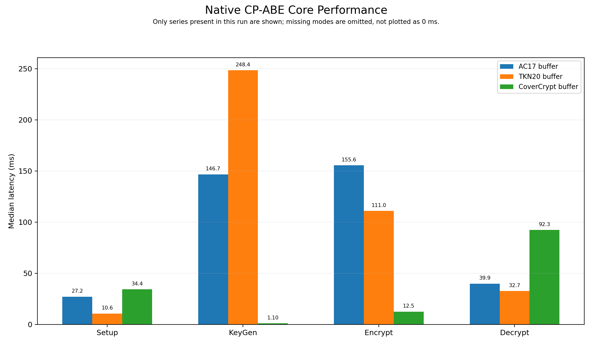
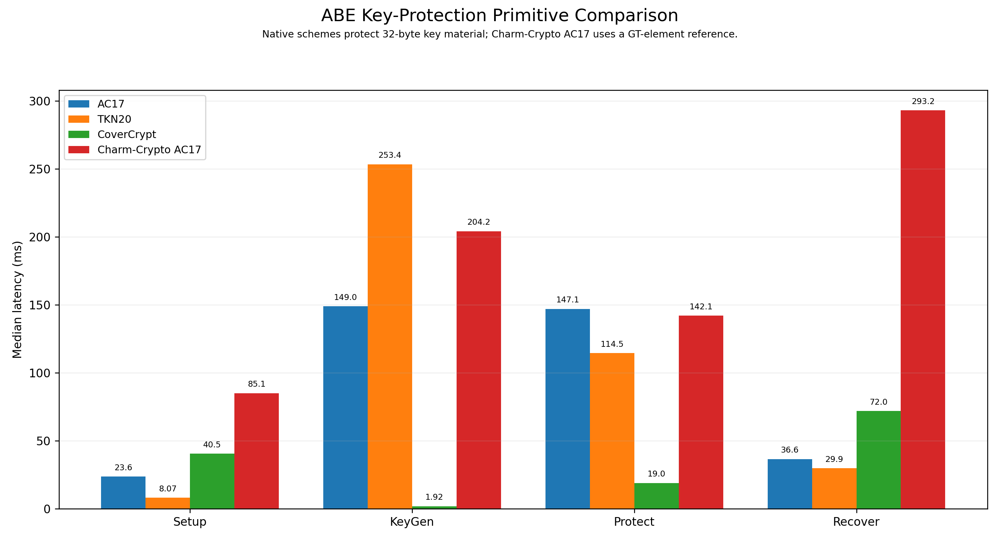
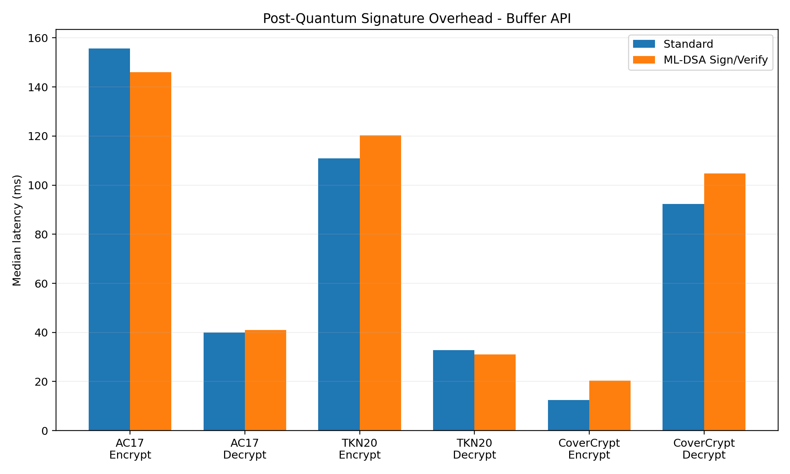

# Benchmarks

### Published Benchmark Snapshot

A reproducible v6.0.0 benchmark snapshot is published under
[`benchmark/published/2026-11-01_i5-12450HX_standard/`](../../benchmark/published/2026-11-01_i5-12450HX_standard/).

Benchmark environment:

- **CPU:** Intel Core i5-12450HX
- **OS:** Windows 10
- **Library:** v6.0.0
- **Profile:** Standard
- **Timed iterations:** 100 after 5 warm-up iterations
- **Payload:** 4 KiB
- **Policy:** 12 terms; CoverCrypt uses 4 dimensions in Hybridized mode
- **Primary metric:** Median latency
- **Outlier policy:** No samples removed

Native Buffer API median latency:

| Scheme | Setup | KeyGen | Encrypt | Decrypt |
| --- | ---: | ---: | ---: | ---: |
| **AC17 Buffer** | 27.184 ms | 146.720 ms | 155.622 ms | 39.902 ms |
| **TKN20 Buffer** | **10.639 ms** | 248.388 ms | 110.973 ms | **32.720 ms** |
| **CoverCrypt Buffer** | 34.372 ms | **1.101 ms** | **12.529 ms** | 92.342 ms |

These are 4 KiB payload measurements. CoverCrypt ran in Hybridized mode
(Curve25519 + ML-KEM-768); its 12-term policy spans four dimensions, with OR
within each dimension and AND between dimensions.

The primitive comparison measures protection and recovery of 32-byte key
material. Charm-Crypto AC17 is included as a GT-element reference, not as a
byte-for-byte equivalent:

| Implementation | Setup | KeyGen | Protect | Recover |
| --- | ---: | ---: | ---: | ---: |
| **AC17** | 23.650 ms | 148.970 ms | 147.055 ms | 36.620 ms |
| **TKN20** | **8.071 ms** | 253.420 ms | 114.548 ms | **29.901 ms** |
| **CoverCrypt** | 40.511 ms | **1.921 ms** | **18.991 ms** | 72.000 ms |
| **Charm-Crypto AC17** | 85.063 ms | 204.176 ms | 142.135 ms | 293.191 ms |

### Post-Quantum Signature Cost

ML-DSA-87 primitive measurements for a 4 KiB message:

| Operation | Median |
| --- | ---: |
| KeyGen | 0.552 ms |
| Sign | 1.135 ms |
| Verify | 0.644 ms |

The benchmark also measures the end-to-end ML-DSA-87 Sign-then-Encrypt path.
Those timings include the ABE and payload operations, so they should not be
interpreted as isolated signature cost. See the snapshot report for per-scheme
results and variability.

### Reproducibility

The published snapshot includes:

- [`report.md`](../../benchmark/published/2026-11-01_i5-12450HX_standard/report.md) — methodology, environment, results, and interpretation notes.
- [`summary.csv`](../../benchmark/published/2026-11-01_i5-12450HX_standard/summary.csv) — median, mean, p95, p99, standard deviation, and coefficient of variation.
- [`raw_samples.csv`](../../benchmark/published/2026-11-01_i5-12450HX_standard/raw_samples.csv) — every recorded timing sample.
- [`benchmark_results.json`](../../benchmark/published/2026-11-01_i5-12450HX_standard/benchmark_results.json) — machine-readable results and benchmark metadata.
- [`charts/`](../../benchmark/published/2026-11-01_i5-12450HX_standard/charts/) — generated benchmark figures.
- [`benchmark/`](../../benchmark/) — scripts and instructions required to reproduce the tests.

!!! important
    **Benchmark comparison scope:** native AC17/TKN20 use the in-memory Buffer
    API and byte-oriented hybrid pipeline. CoverCrypt uses its shared KEM secret
    with AES-GCM to wrap key material. Charm-Crypto AC17 operates on a GT group
    element, so it is a reference rather than a strict equivalent. Results are
    specific to this machine and workload, not universal speedup claims.

!!! note
    This library provides native C/C++ integrations for **AC17**, **TKN20**, and
    **CoverCrypt**. For projects that need a broader research-oriented collection
    of cryptographic schemes such as KP-ABE or IBE, [Charm-Crypto](https://github.com/JHUISI/charm) remains a broader framework.
