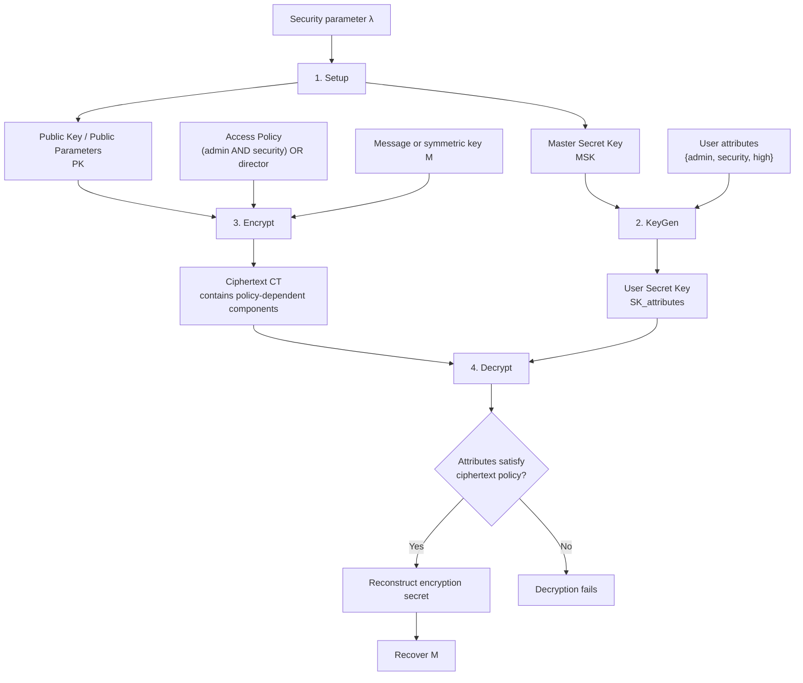
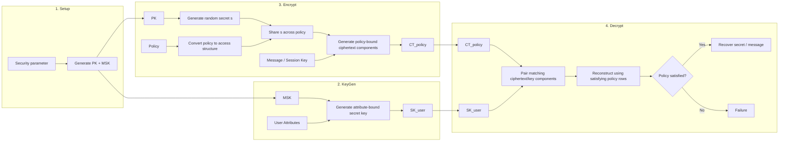
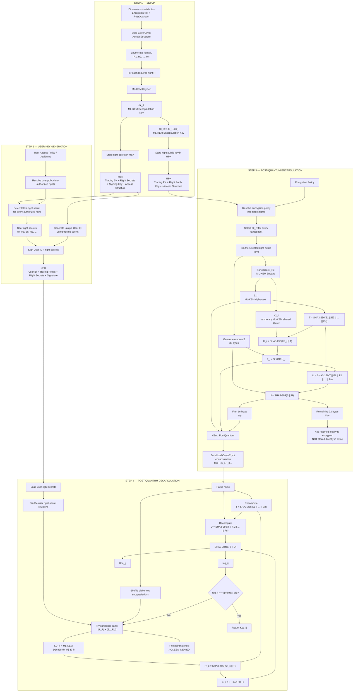
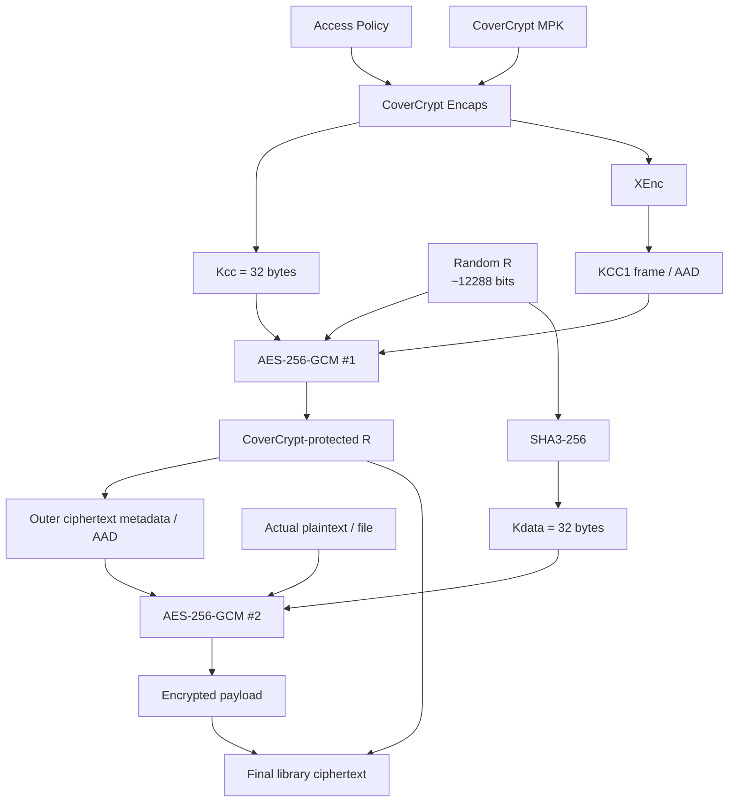
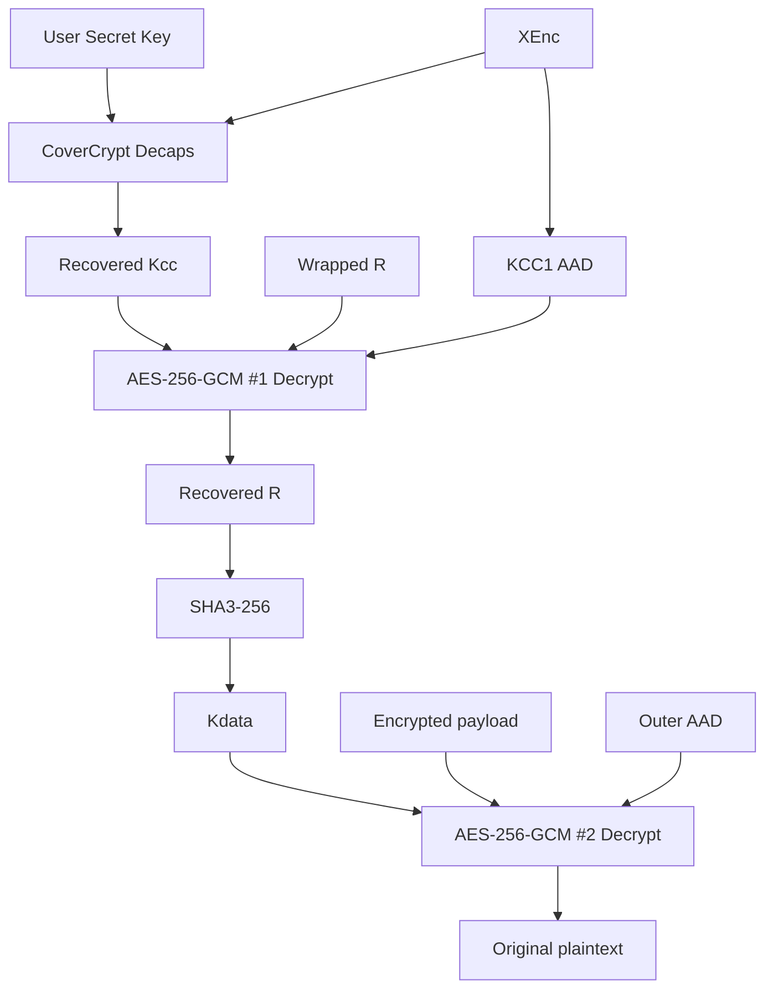

# Cryptographic Workflow

The classical CP-ABE section explains how an authority issues keys and how
an access policy controls decryption. The post-quantum ABE section follows
CoverCrypt in `post_quantum` mode through setup, key issuance, encapsulation,
and decapsulation.

This project's CoverCrypt backend uses ML-KEM-768 for its post-quantum
component. The integration section distinguishes the legacy V2 payload
format from the parameterized V3 format in 6.1.

## Classical CP-ABE

### Policy and workflow

Ciphertext-Policy Attribute-Based Encryption allows the **encryptor** to define an access policy directly inside the ciphertext.

A user receives a secret key associated with a set of attributes.

For example:

```text
User attributes:
    role:admin
    department:security
    clearance:high

Ciphertext policy:
    role:admin AND department:security
```

The user can decrypt because their attributes satisfy the policy.

Formally:

```text
Setup(1^λ)                    -> (PK, MSK)

KeyGen(MSK, Attributes)       -> SK_Attributes

Encrypt(PK, Message, Policy) -> CT_Policy

Decrypt(SK_Attributes, CT_Policy)
    -> Message    if Attributes satisfy Policy
    -> failure    otherwise
```



### Four-step lifecycle

**Step 1 — Setup**

The trusted authority initializes the CP-ABE system.

For a typical pairing-based CP-ABE construction, Setup creates cryptographic group parameters and secret master values.

Conceptually:

```text
Setup(1^λ)

        ↓

Generate cryptographic parameters

        ↓

Generate master secret values

        ↓

Produce:

    PK  = public parameters
    MSK = master authority secret
```

The outputs have different purposes:

```text
PK
└── distributed publicly
    └── used for encryption

MSK
└── kept only by the authority
    └── used to generate user secret keys
```

The `MSK` must never be given to normal users.

**Step 2 — KeyGen**

The authority receives a user's attributes:

```text
A_user = {
    role:admin,
    department:security,
    clearance:high
}
```

and computes:

```text
SK_user = KeyGen(MSK, A_user)
```

The resulting secret key contains cryptographic components associated with the user's attributes.

Conceptually:

```text
MSK
 +
User attributes
      │
      ▼
   KeyGen
      │
      ▼
User Secret Key
```

A secure CP-ABE construction also cryptographically binds the components of one user's key together.

This is important for **collusion resistance**.

For example:

```text
Alice:
    role:admin

Bob:
    department:security
```

should not normally be able to combine their independent secret keys and decrypt:

```text
role:admin AND department:security
```

unless the construction explicitly permits it.

**Step 3 — Encrypt**

The encryptor chooses an access policy:

```text
P = role:admin AND department:security
```

A typical pairing-based CP-ABE scheme generates a fresh random encryption secret:

```text
s ← random
```

The policy is converted into an access structure such as:

- an access tree,
- a threshold structure,
- or an LSSS matrix.

The secret `s` is then mathematically distributed across the policy.

Conceptually:

```text
                         s
                         │
             secret sharing / LSSS
                  ┌──────┴──────┐
                  │             │
                λ1            λ2
                  │             │
               admin        security
```

The values `λ1` and `λ2` are not literal byte fragments of `s`.

They are mathematical shares such that an authorized set of policy rows can reconstruct the value required for decryption.

For an LSSS construction, authorized rows have reconstruction coefficients:

```text
ω1, ω2, ..., ωn
```

such that:

```text
Σ ωi · λi = s
```

The encryptor creates ciphertext components associated with policy attributes.

In pairing-based schemes, these components normally contain group elements involving values derived from:

```text
s
λi
public parameters
attribute identifiers
randomness
```

The encrypted message or session key is then protected by a group value derived from `s`.

Conceptually:

```text
Policy
   │
   ▼
Access structure
   │
   ▼
Random secret s
   │
   ▼
Share s across policy
   │
   ├── attribute component 1
   ├── attribute component 2
   ├── ...
   │
   ▼
Ciphertext
```

In practical hybrid encryption systems, CP-ABE usually protects a **small symmetric key** rather than encrypting a large file directly.

For example:

```text
random symmetric key K
        │
        ├── CP-ABE encrypt K
        │
        └── AES-GCM encrypt actual data
```

**Step 4 — Decrypt**

The decryptor has:

```text
CT_Policy
+
SK_Attributes
```

The implementation determines whether the user's attributes provide a satisfying subset of the ciphertext policy.

For a typical pairing-based construction, ciphertext attribute components are combined with corresponding user secret-key components through bilinear pairing operations.

Conceptually:

```text
Ciphertext component for admin
              +
User key component for admin
              │
              ▼
           pairing
              │
              ▼
        partial value


Ciphertext component for security
              +
User key component for security
              │
              ▼
           pairing
              │
              ▼
        partial value
```

If the policy is satisfied, the decryptor uses the access-structure reconstruction coefficients:

```text
ω1, ω2, ..., ωn
```

to combine these partial values.

Conceptually:

```text
partial_1 ^ ω1
×
partial_2 ^ ω2
×
...
×
partial_n ^ ωn

        ↓

value corresponding to secret s

        ↓

recover protected message/session key
```

If the user's attributes do not satisfy the policy, the required reconstruction coefficients or components do not exist.

Therefore the secret cannot be reconstructed.

**Lifecycle summary**



## Post-quantum ABE

### CoverCrypt rights and key material

CoverCrypt is structurally different from traditional pairing-based CP-ABE.

In the Post-Quantum configuration used by this project, CoverCrypt uses:

```text
ML-KEM-768
+
SHA3
+
XOR masking
+
a rights-based access structure
```

It does **not** reconstruct the encryption secret using bilinear pairings.

Instead, each authorized **right** has ML-KEM key material.

**Rights**

A **right** represents one coordinate in the CoverCrypt access structure.

For example, assume the dimensions are:

```text
role:
    admin
    user

department:
    security
    finance
```

Possible concrete rights can conceptually include combinations such as:

```text
R1 = role:admin + department:security

R2 = role:admin + department:finance

R3 = role:user + department:security

R4 = role:user + department:finance
```

The actual CoverCrypt access structure also supports hierarchy, partial coordinates, revisions, and other policy semantics.

**Post-quantum right keys**

For every Post-Quantum right `R`, CoverCrypt maintains corresponding ML-KEM key material.

Conceptually:

```text
R
│
├── ek_R = ML-KEM Encapsulation Key
│           public side
│
└── dk_R = ML-KEM Decapsulation Key
            secret side
```

In the implementation:

```text
RightSecretKey::PostQuantum {
    dk
}

RightPublicKey::PostQuantum {
    ek
}
```

and:

```text
ek = dk.ek()
```

**Master secret key**

Conceptually:

```text
MSK
├── tracing secret key
├── right secret keys
│   ├── R1 -> dk_R1
│   ├── R2 -> dk_R2
│   └── ...
├── signing key
└── access structure
```

**Master public key**

```text
MPK
├── tracing public information
├── right public keys
│   ├── R1 -> ek_R1
│   ├── R2 -> ek_R2
│   └── ...
└── access structure
```

**User secret key**

```text
USK
├── unique user ID / tracing information
├── tracing points
├── authorized right secret keys
│   ├── dk_Ra
│   ├── dk_Rb
│   └── ...
└── signature
```

**Post-quantum encapsulation structure**

```text
XEnc::PostQuantum
├── tag
└── encapsulations
    ├── (E1, F1)
    ├── (E2, F2)
    └── ...
```

where:

```text
Ei = ML-KEM ciphertext for one selected right

Fi = masking value used to recover the common CoverCrypt secret S
```

### Setup and user key generation

**Setup**

The project calls CoverCrypt Setup with:

```text
dimensions
attributes
encryption mode
```

For Post-Quantum mode:

```text
EncryptionHint::PostQuantum
```

The access structure is first built from the configured dimensions.

Example:

```json
{
  "dimensions": [
    {
      "name": "role",
      "attributes": ["admin", "user"]
    },
    {
      "name": "department",
      "attributes": ["security", "finance"]
    }
  ]
}
```

Conceptually:

```text
Dimensions
    ↓
Attributes
    ↓
AccessStructure
    ↓
Rights Ω
```

The access structure defines a universe of rights:

```text
Ω = {R1, R2, ..., Rn}
```

For every right requiring a new Post-Quantum secret, CoverCrypt runs:

```text
RightSecretKey::random(PostQuantum)
```

which performs:

```text
ML-KEM KeyGen
      │
      ▼
dk_R
```

The public encapsulation key is derived from the decapsulation key:

```text
ek_R = dk_R.ek()
```

Therefore:

```text
Right R
│
├── MSK stores dk_R
│
└── MPK stores ek_R
```

The actual structures are conceptually:

```text
MSK
├── TracingSecretKey
├── RevisionMap
│   ├── R1 -> dk_R1
│   ├── R2 -> dk_R2
│   └── ...
├── USK signing key
└── AccessStructure
```

and:

```text
MPK
├── TracingPublicKey
├── encryption_keys
│   ├── R1 -> ek_R1
│   ├── R2 -> ek_R2
│   └── ...
└── AccessStructure
```

`update_msk()` preserves existing rights where possible.

For a missing right:

```text
RightSecretKey::random()
        ↓
new dk_R
        ↓
derive ek_R
```

For an existing right, its current secret is retained unless its security mode or revision state requires an update.

**User key generation**

The project receives a user access policy such as:

```text
role::admin department::security
```

The project's CoverCrypt adapter uses:

```text
generate_user_secret_key_restricted()
```

The access structure converts this user policy into the set of rights the user is authorized to possess.

Conceptually:

```text
User attributes
      │
      ▼
AccessStructure
      │
      ▼
Authorized rights

{Ra, Rb, Rc, ...}
```

For every authorized right, CoverCrypt retrieves the latest corresponding secret from the MSK:

```text
Ra -> dk_Ra
Rb -> dk_Rb
Rc -> dk_Rc
```

Then CoverCrypt generates a unique user identity:

```text
UserId ← TracingSecretKey
```

It also signs the generated user key material when the MSK signing key is present.

The resulting USK is approximately:

```text
USK
├── id
│   └── unique tracing-aware user identity
│
├── ps
│   └── tracing public points
│
├── secrets
│   ├── Ra -> dk_Ra
│   ├── Rb -> dk_Rb
│   └── Rc -> dk_Rc
│
└── signature
```

Therefore two users with the same rights may contain the same underlying right-secret components:

```text
Alice:
    dk_R1
    dk_R2

Bob:
    dk_R1
    dk_R2
```

but their complete USKs are still different because their user IDs and tracing/signature information differ.

This does **not** prevent key sharing.

If Alice gives Bob her complete USK, Bob can exercise Alice's cryptographic rights.

Tracing provides attribution/tracing mechanisms, not hardware-enforced non-transferability.

### Encapsulation

Assume an encryption policy resolves to:

```text
R1
R2
R3
```

The MPK contains:

```text
R1 -> ek_1
R2 -> ek_2
R3 -> ek_3
```

CoverCrypt selects these public keys.

Before generating the final encapsulations, their ordering is shuffled.

**Common secret `S`**

CoverCrypt generates:

```text
S ← random 32 bytes
```

This is an internal random secret.

It is **not** produced by ML-KEM.

```text
CoverCrypt RNG
      │
      ▼
S
```

**ML-KEM encapsulation for each authorized right**

For each selected public key:

```text
ML-KEM.Encaps(ek_i)
```

returns:

```text
(K2_i, E_i)
```

where:

```text
K2_i = temporary 32-byte ML-KEM shared secret

E_i  = ML-KEM ciphertext / encapsulation
```

For example:

```text
ek_1
  │
  ▼
ML-KEM Encaps
  │
  ├── K2_1
  └── E_1


ek_2
  │
  ▼
ML-KEM Encaps
  │
  ├── K2_2
  └── E_2
```

ML-KEM does **not** produce `F`.

`F` is produced later by CoverCrypt.

**ML-KEM encapsulation internals**

At a high level, ML-KEM generates a fresh random message-like value:

```text
m ← random 32 bytes
```

and combines it with the hash of the encapsulation key.

Conceptually:

```text
m || H(ek)
      │
      ▼
      G
      │
      ▼
K2 || r
```

where:

```text
K2 = shared secret

r  = deterministic encryption randomness
```

The underlying lattice encryption then creates:

```text
E = PKE.Encrypt(ek, m; r)
```

and the encapsulation operation returns:

```text
(K2, E)
```

The important property is:

```text
Sender:
    ek + Encaps
        -> K2 + E

Receiver:
    dk + E
        -> same K2
```

`K2` itself is never transmitted directly.

**Encapsulation transcript `T`**

After all ML-KEM encapsulations are generated:

```text
E1
E2
...
En
```

CoverCrypt serializes and hashes them:

```text
T = SHA3-256(
        serialize(E1)
        ||
        serialize(E2)
        ||
        ...
        ||
        serialize(En)
    )
```

Therefore:

```text
T = 32 bytes
```

This binds the following masking computation to the complete encapsulation set.

**Masking `S` for each right**

For every right `Ri`, CoverCrypt computes:

```text
H_i = SHA3-256(K2_i || T)
```

Then:

```text
F_i = S XOR H_i
```

Therefore:

```text
K2_1 + T
    │
    ▼
 SHA3-256
    │
    ▼
   H_1

S XOR H_1
    │
    ▼
   F_1
```

Likewise:

```text
F_2 = S XOR SHA3-256(K2_2 || T)

F_3 = S XOR SHA3-256(K2_3 || T)
```

All rights therefore protect the **same S**.

For example:

```text
                    S
             ┌──────┼──────┐
             │      │      │
             ▼      ▼      ▼
            XOR    XOR    XOR
             ▲      ▲      ▲
             │      │      │
            H1     H2     H3
             ▲      ▲      ▲
             │      │      │
            K2_1   K2_2   K2_3

             │      │      │
             ▼      ▼      ▼

            F1     F2     F3
```

A user only needs to recover one valid `K2_i` to recover the common `S`.

**Mask transcript `U`**

After generating all `F_i` values:

```text
U = SHA3-256(
        T
        ||
        F1
        ||
        F2
        ||
        ...
        ||
        Fn
    )
```

Therefore:

```text
U = 32 bytes
```

`U` binds the final secret derivation to the whole set of masking values.

**Tag and shared secret `Kcc`**

CoverCrypt computes:

```text
J = SHA3-384(S || U)
```

SHA3-384 produces:

```text
48 bytes
```

CoverCrypt splits the result:

```text
48 bytes
┌────────────────┬────────────────────────────────┐
│ first 16 bytes │ remaining 32 bytes             │
│                │                                │
│ tag            │ Kcc                            │
└────────────────┴────────────────────────────────┘
```

Therefore:

```text
(tag, Kcc) = J_hash(S, U)
```

where:

```text
tag = 16 bytes
Kcc = 32 bytes
```

The final Post-Quantum CoverCrypt encapsulation is:

```text
XEnc
├── tag
└── encapsulations
    ├── (E1, F1)
    ├── (E2, F2)
    ├── ...
    └── (En, Fn)
```

while `Kcc` is returned separately to the encrypting caller.

So the actual CoverCrypt KEM output is:

```text
CoverCrypt.Encaps(MPK, Policy)

        ↓

(Kcc, XEnc)
```

`Kcc` is **not stored in plaintext inside `XEnc`**.

**Encapsulation formulas**

For target rights:

```text
R1 ... Rn
```

CoverCrypt performs:

```text
S ← Random(32 bytes)

for each Ri:

    (K2_i, E_i) = ML-KEM.Encaps(ek_i)


T = SHA3-256(E1 || E2 || ... || En)


for each Ri:

    H_i = SHA3-256(K2_i || T)

    F_i = S XOR H_i


U = SHA3-256(T || F1 || F2 || ... || Fn)


J = SHA3-384(S || U)

tag = J[0:16]

Kcc = J[16:48]
```

Final output:

```text
Kcc

XEnc = {
    tag,
    (E1,F1),
    (E2,F2),
    ...
    (En,Fn)
}
```

### Decapsulation and access checks

The receiver has:

```text
USK
+
XEnc
```

The XEnc contains:

```text
tag

(E1,F1)
(E2,F2)
...
(En,Fn)
```

The USK contains one or more right secret keys:

```text
dk_Ra
dk_Rb
...
```

**Recompute `T`**

The receiver has all `E_i` values, so it independently computes:

```text
T = SHA3-256(E1 || E2 || ... || En)
```

This is exactly the same `T` used by the encryptor.

**Recompute `U`**

The receiver also has all `F_i` values:

```text
U = SHA3-256(T || F1 || F2 || ... || Fn)
```

Again, this produces the same `U` used by the encryptor.

**Shuffle candidate order**

CoverCrypt shuffles:

```text
ciphertext encapsulations
```

and user secret-key revisions.

The purpose is to reduce timing leakage.

Without shuffling, if the implementation always tested:

```text
R1
R2
R3
R4
...
```

and stopped immediately after finding a match, runtime could correlate with the position of the matching right.

Shuffling changes this order between operations.

It does **not** improve asymptotic performance.

**Recover a candidate secret**

For a candidate pair:

```text
dk_Rj
+
(E_i, F_i)
```

CoverCrypt runs:

```text
K2'_ij = ML-KEM.Decaps(dk_Rj, E_i)
```

If `dk_Rj` is the correct decapsulation key corresponding to `E_i`:

```text
K2'_ij = K2_i
```

If it is not correct, ML-KEM's implicit-rejection behavior produces a value that behaves like an unrelated shared secret.

CoverCrypt then computes:

```text
H'_ij = SHA3-256(K2'_ij || T)
```

and attempts to reconstruct:

```text
S_ij = F_i XOR H'_ij
```

If the right key is correct:

```text
H'_ij = H_i
```

therefore:

```text
S_ij
= F_i XOR H_i

= (S XOR H_i) XOR H_i

= S
```

because:

```text
X XOR X = 0
```

and:

```text
S XOR 0 = S
```

So the authorized user reconstructs the exact same `S`.

**Verify the candidate tag**

Recovering some 32-byte `S_ij` is not enough.

CoverCrypt checks whether it is the correct `S`.

It computes:

```text
J_ij = SHA3-384(S_ij || U)
```

and splits it:

```text
(tag_ij, Kcc_ij)
```

Then:

```text
tag_ij == XEnc.tag ?
```

If:

```text
tag_ij != tag
```

then this candidate was wrong.

CoverCrypt tries another:

```text
dk × (E,F)
```

pair.

If:

```text
tag_ij == tag
```

then:

```text
S_ij = correct S
```

with overwhelming cryptographic probability, and CoverCrypt returns:

```text
Kcc_ij
```

which equals the encryptor's:

```text
Kcc
```

**Decapsulation loop**

Conceptually:

```text
for each USK revision:

    shuffle(right secrets)

    for each ciphertext (E_i, F_i):

        for each user right secret dk_j:

            K2 = ML-KEM.Decaps(dk_j, E_i)

            H = SHA3-256(K2 || T)

            S_candidate = F_i XOR H

            (tag_candidate, Kcc_candidate)
                = SHA3-384(S_candidate || U)

            if tag_candidate == ciphertext.tag:

                return Kcc_candidate
```

If nothing matches:

```text
return ACCESS_DENIED
```

The project then maps that result to:

```text
HCPABE_ERR_POLICY_MISMATCH
```

**Matching rights and search cost**

The ciphertext does not need to expose something like:

```text
"This encapsulation belongs to right R17"
```

If such an identifier were directly available:

```text
right_id -> encapsulation
```

the user could simply perform:

```text
USK[right_id]
```

and achieve approximately constant-time lookup.

However, this would expose information about the rights targeted by the ciphertext.

Instead, Post-Quantum CoverCrypt tries candidate right secrets against candidate encapsulations and verifies the result using the tag.

For:

```text
U = number of user right-secret candidates

C = number of ciphertext encapsulations
```

the basic worst-case matching cost is approximately:

```text
O(U × C)
```

for a single revision.

With multiple key revisions, the revision dimension adds another factor.

**ML-KEM decapsulation internals**

ML-KEM does not recover `K2` by directly decrypting `K2` from the ciphertext.

Conceptually, encapsulation generated:

```text
m
  │
  ▼
derive K2 and randomness r
  │
  ├── K2
  │
  └── r
       │
       ▼
encrypt m
       │
       ▼
       E
```

During decapsulation:

```text
dk + E
   │
   ▼
recover m'
   │
   ▼
derive K2' and r'
   │
   ▼
re-encrypt m'
   │
   ▼
E'
```

ML-KEM verifies the ciphertext internally.

Conceptually:

```text
E' == E
```

If valid:

```text
return K2'
```

If invalid:

```text
return implicit-rejection secret
```

rather than exposing a simple decryption-failure oracle.

CoverCrypt itself then detects whether the returned shared secret was useful through:

```text
S_candidate
      ↓
J_hash
      ↓
tag_candidate
      ↓
compare with XEnc.tag
```

**How ML-KEM protects the mask**

ML-KEM produces:

```text
K2_i + E_i
```

CoverCrypt then uses:

```text
K2_i
    ↓
SHA3
    ↓
mask
    ↓
S XOR mask
    ↓
F_i
```

So:

```text
ML-KEM protects the ability to derive the mask.

CoverCrypt uses that mask to protect S.
```

**Internal secret and shared secret**

CoverCrypt first generates:

```text
S
```

but derives:

```text
Kcc
```

from:

```text
SHA3-384(S || U)
```

Therefore:

```text
S != Kcc
```

`S` is an internal common secret used to construct the encapsulation.

`Kcc` is the final KEM shared secret returned to the caller.

**ML-KEM implicit rejection**

ML-KEM uses implicit rejection.

A wrong candidate produces an unrelated shared-secret value.

That causes:

```text
wrong K2
    ↓
wrong H
    ↓
wrong S
    ↓
wrong tag
```

and CoverCrypt rejects the candidate when:

```text
tag_candidate != tag
```

**CoverCrypt access denial**

If no candidate succeeds:

```text
CoverCrypt.Decaps
    -> None / ACCESS_DENIED
```

The project maps this to:

```text
HCPABE_ERR_POLICY_MISMATCH
```

There is no need for the outer project layer to invent another fake `Kcc`.

ML-KEM already performs implicit rejection at the cryptographic layer where it is required.

**Candidate order and timing**

CoverCrypt shuffles candidate orders before attempting decapsulation.

This reduces the correlation between:

```text
decryption time
```

and:

```text
which user right matched the ciphertext
```

It does not change the worst-case search complexity.

### End-to-end workflow diagrams

**Four-step workflow**



**Data relationships**

```mermaid
flowchart LR

    subgraph AUTHORITY["Authority"]
        R["Right R"]
        R --> KEYGEN["ML-KEM KeyGen"]
        KEYGEN --> EK["ek_R"]
        KEYGEN --> DK["dk_R"]

        EK --> MPK["MPK"]
        DK --> MSK["MSK"]
    end

    subgraph USER["User Key"]
        MSK --> UKG["User KeyGen"]
        UA["User attributes"] --> UKG
        UKG --> USK["USK containing authorized dk_R"]
    end

    subgraph ENCRYPTOR["Encryptor"]
        MPK --> ENC["Resolve policy rights"]

        ENC --> EKM["Selected ek_R"]

        EKM --> MLENC["ML-KEM Encaps"]

        MLENC --> K2["K2_i"]
        MLENC --> EI["E_i"]

        S["Random S = 32 bytes"]

        EI --> T["T = SHA3-256(all E_i)"]

        K2 --> HH["H_i = SHA3-256(K2_i || T)"]
        T --> HH

        HH --> FF["F_i = S XOR H_i"]
        S --> FF

        T --> U["U = SHA3-256(T || all F_i)"]
        FF --> U

        S --> J["SHA3-384(S || U)"]
        U --> J

        J --> TAG["tag = first 16 bytes"]
        J --> KCC1["Kcc = final 32 bytes"]

        TAG --> XENC["XEnc"]
        EI --> XENC
        FF --> XENC
    end

    subgraph RECEIVER["Receiver"]
        USK --> TRY["Try dk_R against E_i"]
        XENC --> TRY

        TRY --> MLDEC["ML-KEM Decaps"]
        MLDEC --> K2P["K2'_ij"]

        K2P --> HP["H' = SHA3-256(K2' || T)"]

        HP --> SP["S' = F_i XOR H'"]

        SP --> JP["SHA3-384(S' || U)"]

        JP --> TAGP["tag'"]
        JP --> KCC2["Kcc'"]

        TAGP --> CMP{"tag' == tag?"}

        CMP -->|Yes| KCCOK["Kcc' = Kcc"]
        CMP -->|No| TRY
    end

    XENC --> RECEIVER
```



**Workflow formulas and data flow**

The complete Post-Quantum flow can be reduced to:

```text
SETUP
=====

Dimensions + attributes
        │
        ▼
AccessStructure
        │
        ▼
Rights Ω
        │
        ▼
For every PostQuantum right:
ML-KEM KeyGen
        │
        ├── dk_R -> MSK
        └── ek_R -> MPK
```

```text
GENKEY
======

MSK
+
User attributes
        │
        ▼
Resolve authorized rights
        │
        ▼
Select corresponding dk_R
        │
        +
Unique UserId
        +
Tracing data
        +
Signature
        │
        ▼
USK
```

```text
ENCAPS
======

Encryption policy
        │
        ▼
Target rights
        │
        ▼
ek_R1 ... ek_Rn
        │
        ▼
ML-KEM Encaps for each right
        │
        ├── K2_i
        └── E_i

S <- random 32 bytes

T = SHA3-256(all E_i)

H_i = SHA3-256(K2_i || T)

F_i = S XOR H_i

U = SHA3-256(T || all F_i)

SHA3-384(S || U)
        │
        ├── tag = 16 bytes
        └── Kcc = 32 bytes

XEnc = tag + all (E_i,F_i)
```

```text
DECAPS
======

USK
+
XEnc
        │
        ▼
Recompute T and U
        │
        ▼
Shuffle candidate order
        │
        ▼

For each candidate:

    dk_j + E_i
        │
        ▼
    ML-KEM Decaps
        │
        ▼
    K2'_ij
        │
        ▼
    H' = SHA3-256(K2'_ij || T)
        │
        ▼
    S' = F_i XOR H'
        │
        ▼
    SHA3-384(S' || U)
        │
        ├── tag'
        └── Kcc'

    tag' == tag ?
        │
        ├── NO  -> try next pair
        │
        └── YES -> return Kcc'
```

### Library integration and ciphertext formats

**Legacy V2 workflow**

The detailed adapter and payload examples below use legacy V2. The
CoverCrypt adapter wraps the core's random value in a `KCC1` frame. The
core then derives the AES-256-GCM payload key from that value.

The upstream CoverCrypt KEM produces:

```text
(Kcc, XEnc)
```

However, this project's common CP-ABE interface expects each ABE backend to protect a caller-supplied random value.

The core generates a random value `R`:

```text
R ← CryptoPP random integer
```

currently created with approximately:

```text
12288 bits
≈ 1536 bytes
```

The core then calls:

```text
covercrypt_encapsulate_key(
    MPK,
    policy,
    R
)
```

But CoverCrypt itself does not accept an arbitrary `R` as its KEM secret.

Instead it independently produces:

```text
Kcc
+
XEnc
```

Therefore the CoverCrypt adapter uses `Kcc` to encrypt `R`.

**AES-GCM layer 1 — CoverCrypt adapter**

The adapter performs:

```text
CoverCrypt.Encaps
       │
       ▼
Kcc + XEnc
```

Then generates a fresh 12-byte AES-GCM IV and constructs the `KCC1` frame.

It performs:

```text
AES-256-GCM(
    key       = Kcc,
    plaintext = R,
    AAD       = KCC1 header + XEnc
)
```

Therefore:

```text
Kcc
 │
 ▼
AES-256-GCM
 │
 ├── plaintext = R
 │
 └── AAD = CoverCrypt encapsulation metadata
 │
 ▼
Encrypted R
```

The resulting adapter ciphertext contains conceptually:

```text
KCC1 frame
├── format identifier
├── XEnc length
├── AES-GCM IV
├── serialized XEnc
└── AES-GCM ciphertext/tag protecting R
```

This AES-GCM layer belongs to the **project adapter**, not to the Post-Quantum CoverCrypt primitive described above.

**AES-GCM layer 2 — payload**

After the CoverCrypt adapter has protected `R`, the common library core derives:

```text
Kdata = SHA3-256(R)
```

Therefore:

```text
Kdata = 32 bytes
```

which is used as an AES-256 key.

The actual payload is encrypted with another independent AES-GCM operation:

```text
AES-256-GCM(
    key       = Kdata,
    plaintext = actual user data,
    AAD       = outer ciphertext metadata
)
```

So the complete encryption chain is:



**Library decryption**

The receiver first obtains:

```text
USK
+
Final Ciphertext
```

The core extracts the CoverCrypt-protected `R`.

The CoverCrypt adapter parses:

```text
KCC1
```

and obtains:

```text
XEnc
AES-GCM ciphertext of R
```

Then:

```text
USK + XEnc
      │
      ▼
CoverCrypt.Decaps
      │
      ▼
Kcc
```

The adapter performs:

```text
AES-256-GCM #1 decrypt
```

using:

```text
key = Kcc
```

and recovers:

```text
R
```

The common core then computes:

```text
Kdata = SHA3-256(R)
```

and finally:

```text
AES-256-GCM #2 decrypt
```

to recover the actual payload.



**Parameterized V3 workflow**

V3 protects a fresh 32-byte seed through ABE. The CoverCrypt adapter still
uses AES-256-GCM to wrap that seed. The outer payload key is derived from
the seed and header metadata for the selected AES size of 128, 192, or 256
bits. [V3 wire format and signature binding](../native/parameters.md#v3-wire-format)

## Comparison and implementation references

### Classical CP-ABE and post-quantum CoverCrypt

| Property | Traditional pairing-based CP-ABE | CoverCrypt Post-Quantum |
|---|---|---|
| Fundamental mechanism | Bilinear pairing / secret sharing | Rights + ML-KEM + hashing + XOR |
| Encryption secret | Random `s` | Random `S` |
| Policy representation | Access tree / LSSS / similar | CoverCrypt access structure and rights |
| User key | Attribute-bound secret components | Right secret keys + user/tracing metadata |
| Ciphertext policy components | Attribute/group components | `(E_i, F_i)` per selected right |
| Main public-key primitive | Pairing-based cryptography | ML-KEM-768 |
| Recover secret | Pairings + reconstruction coefficients | ML-KEM decapsulation + XOR |
| Authorization verification | Successful policy reconstruction | `tag_candidate == tag` |
| Final CoverCrypt shared secret | Scheme-specific | `Kcc = J_hash(S,U)` |
| Quantum resistance | Generally no for classical pairing schemes | Yes against currently known quantum attacks |
| Right matching | Policy reconstruction | Candidate secret × encapsulation search |

### Source references

The CoverCrypt description above corresponds to the current project implementation in:

```text
bindings/covercrypt/src/lib.rs
```

Project-owned CoverCrypt C ABI:

```text
cc_setup
cc_genkey
cc_encaps
cc_decaps
```

Core CoverCrypt structures:

```text
vendor/cover_crypt/src/abe/core/mod.rs
```

including:

```text
RightSecretKey
RightPublicKey
MasterSecretKey
MasterPublicKey
UserSecretKey
XEnc
```

Core CoverCrypt cryptographic operations:

```text
vendor/cover_crypt/src/abe/core/primitives.rs
```

including:

```text
usk_keygen
post_quantum_encaps
partial_post_quantum_decaps
attempt_post_quantum_decaps
H_hash
generate_T
generate_U
J_hash
update_msk
```

CoverCrypt public API:

```text
vendor/cover_crypt/src/abe/api.rs
```

Project C++ CoverCrypt adapter:

```text
src/schemes/covercrypt.cpp
```

including:

```text
covercrypt_encapsulate_key
covercrypt_decapsulate_key
```

Common hybrid encryption core:

```text
src/core/abe-encrypt.cpp
src/core/abe-decrypt.cpp
```

AES-GCM implementation:

```text
src/crypto/aes-gcm.cpp
```

The current CoverCrypt Rust dependency is compiled with:

```toml
features = ["curve25519", "mlkem-768"]
```

in:

```text
bindings/covercrypt/Cargo.toml
```

Therefore the CoverCrypt Post-Quantum path described in this document uses:

```text
ML-KEM-768
```

even though the project separately exposes standalone ML-KEM primitives for multiple ML-KEM parameter sets.
