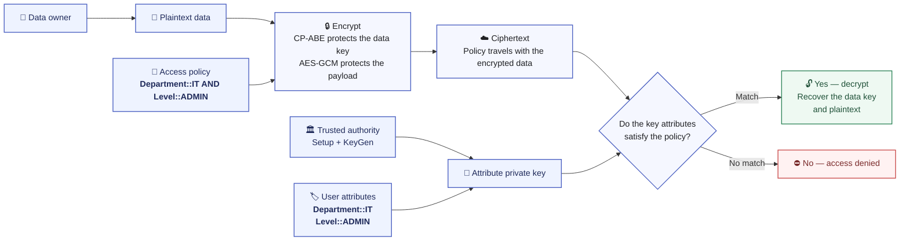

# What is PQ-CP-ABE?

Imagine a team needs to share a confidential file with anyone from the IT
department who has an administrator role. With ordinary encryption, the sender
usually has to manage recipients or distribute keys separately. **Ciphertext-Policy Attribute-based Encryption (CP-ABE)** lets the sender attach an access
rule to the encrypted data instead. A trusted authority issues keys carrying
attributes, and only a key whose attributes satisfy the rule can unlock the
data-encryption key.

This makes access control travel with the ciphertext: the policy can describe
which roles or properties are allowed, rather than naming each recipient.
Applications can use this for controlled sharing across teams or services, as
long as they have a trusted process for issuing and managing attribute keys.

## How CP-ABE works

The important distinction is that the **ciphertext carries the access policy**, while
the **user's private key carries attributes**. Decryption succeeds only when those
attributes satisfy the policy embedded in the ciphertext.

**Post-quantum (PQ)** refers to cryptographic techniques designed to resist
attacks by quantum computers. PQ-CP-ABE combines policy-based encryption with
post-quantum cryptography, but the exact protection depends on the algorithms
and mode in use. A system is not post-quantum merely because it uses attribute
policies or adds post-quantum signatures.

## Who can benefit from this approach?

PQ-CP-ABE can be useful when data must be shared under fine-grained rules, but
the storage provider should not be trusted with the plaintext or the decryption
keys. Typical examples include:

- **Cloud and hosted storage:** encrypt files in the application before upload,
  then let the cloud store ciphertext without being the authority that decides
  who can decrypt it. This is useful when an organization wants its own
  attribute-based access policy rather than relying only on a provider's
  account permissions.
- **Healthcare and research:** share records with authorized care teams or
  research groups according to attributes such as department, role, or project.
- **Enterprise documents:** control access to contracts, financial records, or
  internal documents shared across teams, offices, or external partners.
- **Long-lived sensitive data:** consider a post-quantum mode when planning for
  information that needs confidentiality over a long period. NIST's
  [ML-KEM standard (FIPS 203)](https://csrc.nist.gov/pubs/fips/203/final)
  describes a key-encapsulation mechanism intended to withstand attacks by
  quantum computers.

If only ciphertext is exposed, its contents should remain confidential when
encryption is correctly configured and the required keys remain protected.
Encryption does not hide all metadata or prevent deletion, and it cannot protect
plaintext on a compromised device or from an authorized user who misuses their
key. Post-quantum protection also depends on the selected algorithms and mode:
in this project, AC17 and TKN20 are classical; CoverCrypt's `hybridized` and
`post_quantum` modes use ML-KEM-768 for key encapsulation. See the
[architecture guide](../architecture/README.md) for the mode details.

## About the library

Hybrid PQ-CP-ABE is a cryptographic library and SDK for **ciphertext-policy
attribute-based encryption (CP-ABE)**. It lets an application encrypt data under
a policy such as `Department::IT AND Level::ADMIN`; a user's key can decrypt the
data only when its attributes satisfy that policy. This is useful when access
should be governed by roles or attributes rather than by maintaining a separate
encrypted copy for every recipient.

The library uses CP-ABE to protect a data-encryption key and AES-GCM to encrypt
the actual payload. Applications can choose AC17, TKN20, or CoverCrypt. CoverCrypt
supports classic, hybridized, and post-quantum modes; optional ML-DSA signatures
provide message authenticity independently of the selected ABE scheme. AC17 and
TKN20 remain classical schemes, and adding signatures does not make them
post-quantum.

The same native library is available through C/C++, Python, and JavaScript /
WebAssembly SDKs, as well as a command-line tool and a HashiCorp Vault
integration. This lets applications use policy-based encryption through the
interface and runtime that best fit their environment.

## Language bindings

The repository provides two primary developer SDKs. The native library and command-line tool have their own [build guide](../native/build.md) and [CLI reference](../native/cli.md).

| SDK | Runtime | Start here | API reference |
| --- | --- | --- | --- |
| Python | Native shared library via `ctypes` (Windows DLL, Linux SO, macOS DYLIB) | [Python guide](python/README.md) | [Python API](python/api.md) |
| JavaScript / TypeScript | WebAssembly (Emscripten C++/Rust + Go TKN20 runtime), in Node.js and browsers | [WASM guide](wasm/README.md) | [JavaScript API](wasm/api.md) |

- Python package: [`pq-cp-abe` on PyPI](https://pypi.org/project/pq-cp-abe/).
- JavaScript package: [`@wanthinnn/pq-cp-abe` on npm](https://www.npmjs.com/package/@wanthinnn/pq-cp-abe).
- [Architecture and cryptographic modes](../architecture/README.md) · [Parameters and wire format](../native/parameters.md).

**Security boundary:** AC17 and TKN20 are classical ABE schemes. CoverCrypt supports ML-KEM-768 in `HYBRIDIZED` and `POST_QUANTUM` modes. Optional ML-DSA signing is independent and does not turn classical ABE into quantum-resistant ABE.
